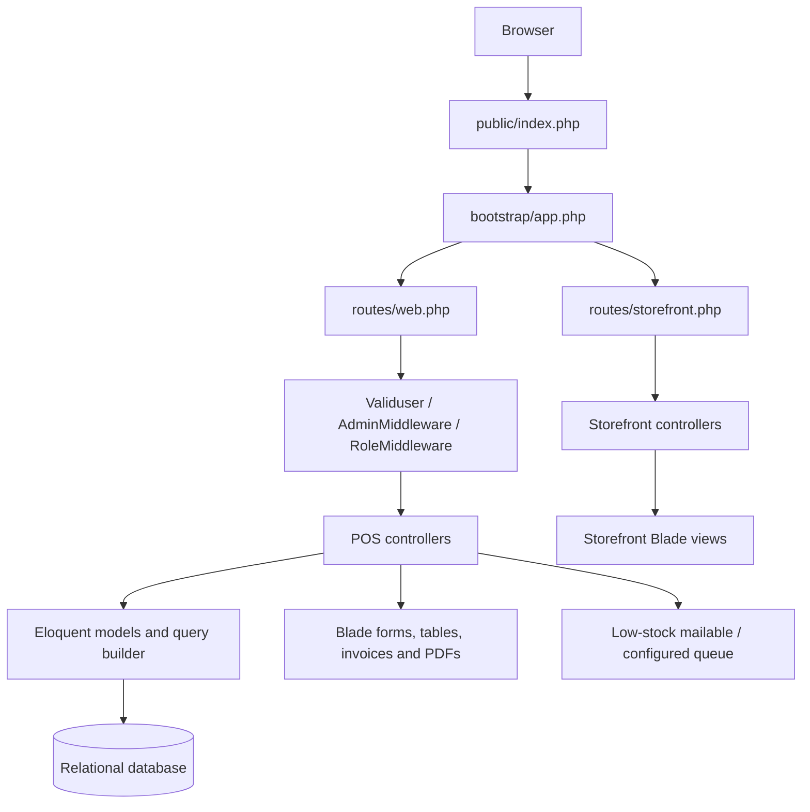
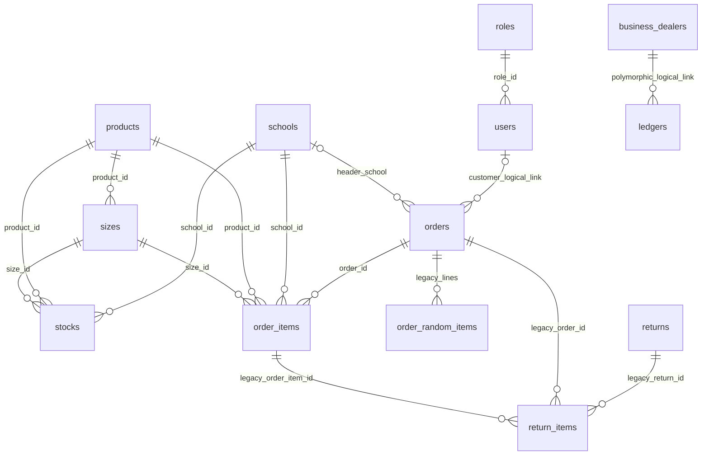

# Best Uniform POS: System and Contributor Guide

Last analyzed: 2026-10-13.

This guide describes the code currently in this working tree, including local changes. It is intended for developers and coding agents working on the Point of Sale (POS). It records implemented behavior separately from incomplete or legacy features.

The analysis covered routes, controllers, middleware, models, all 45 migrations, seeders, configuration, tests, and the main POS and storefront views. The migrations declare 27 tables, excluding Laravel's migration-tracking table. The database schema below is reconstructed from migration source; no live database schema or customer records were inspected, and migrations and seeders were not executed. Whether every migration has been applied to a particular installation must be checked separately.

## Contents

- [System Overview](#system-overview)
- [Architecture and File Map](#architecture-and-file-map)
- [Authentication and Permissions](#authentication-and-permissions)
- [Business Workflows](#business-workflows)
- [Database Schema](#database-schema)
- [Setup and Operations](#setup-and-operations)
- [Known Gaps and Risks](#known-gaps-and-risks)
- [Guidelines for Future Changes](#guidelines-for-future-changes)
- [Verification Baseline](#verification-baseline)

## System Overview

This is a Laravel application for selling school uniforms. Its central inventory unit is a combination of **school, product, and size**. Each stock record holds a quantity, cost price, selling price, and generated product code. Sales add the school's percentage margin, apply an order discount, decrease inventory, and produce a printable invoice.

The application contains two distinct interfaces:

| Interface | Entry Points | Current Behavior |
| --- | --- | --- |
| Administrative POS | `/login`, `/`, `/order`, `/orders` | Database-backed inventory, sales, returns, reports, users, permissions, expenses, dealer ledgers, and daily accounts. Some registered routes are incomplete. |
| Customer storefront | `/frontend`, `/test`, `/all-products`, `/frontend/...` | Blade storefront pages. Controllers currently return views without querying the POS catalog or implementing checkout, customer registration, or address persistence. |

There is no separate API route file, SPA application, payment-gateway integration, or service/repository layer in the inspected application code. The `card_payment` field records a payment flag; it does not process a card transaction.

### Technology

| Component | Source and Use |
| --- | --- |
| PHP | `^8.2` in [composer.json](composer.json). |
| Laravel | `^11.0`; installed runtime reported **11.8.0** during analysis. |
| Authentication scaffolding | `laravel/ui ^4.5`, plus custom login actions and middleware. |
| Database access | Eloquent models and query builder. Configuration defaults to SQLite, but the dashboard contains MySQL-specific `DATE_FORMAT` SQL. MySQL/MariaDB compatibility matters for the actual POS. |
| PDFs | `barryvdh/laravel-dompdf ^3.0`; report controllers mostly instantiate `Dompdf` directly. |
| Database tooling | `doctrine/dbal ^4.2`. |
| Admin UI | Blade, AdminLTE assets, Bootstrap, jQuery, Select2, Font Awesome, and inline page scripts. |
| Asset build | Vite 5, Laravel Vite plugin, Sass, Bootstrap 5, Axios. These coexist with directly loaded assets and Bootstrap 4 scripts in the admin layout. |
| Tests and formatting | PHPUnit 11, Laravel test runner, Laravel Pint. |
| Time zone | `APP_TIMEZONE`, defaulting to `Asia/Karachi` in [config/app.php](config/app.php). Invoice formatting explicitly uses the same zone. |

Dependency constraints above come from the project manifests, not a claim about the latest available package versions.

## Architecture and File Map



Both route files receive Laravel's `web` middleware. The storefront file is registered by the `then` callback in [bootstrap/app.php](bootstrap/app.php). The bootstrap also registers `/up` as the health endpoint and [routes/console.php](routes/console.php) for console commands. The only scheduled command declared there is the scaffold `inspire` command; there is no stock-alert schedule.

Most business logic lives directly in controllers. CRUD handlers usually validate a request, assign model properties, save, flash a session message, and redirect. Sales, returns, searches, and report fetching also use JSON responses consumed by jQuery in Blade templates. There are 26 controller files, including the base controller, and 20 model files.

| Area | Main Files | Responsibility |
| --- | --- | --- |
| Dashboard and login | [UserController.php](app/Http/Controllers/UserController.php), `resources/views/index.blade.php`, `resources/views/auth/login.blade.php` | Authentication, summary metrics, recent orders, monthly order-count chart, shared to-do list. |
| Staff and customer records | [HomeController.php](app/Http/Controllers/HomeController.php), [User.php](app/Models/User.php) | User CRUD. The same users table also stores POS customers. |
| Roles and permissions | [AdminController.php](app/Http/Controllers/AdminController.php), [PermissionController.php](app/Http/Controllers/PermissionController.php) | Role CRUD, permission-name CRUD, and JSON permission assignment. |
| Catalog | [ProductController.php](app/Http/Controllers/ProductController.php), [SizeController.php](app/Http/Controllers/SizeController.php), [SchoolController.php](app/Http/Controllers/SchoolController.php) | Products, product-specific sizes, schools, and school margin percentages. |
| Inventory | [StockController.php](app/Http/Controllers/StockController.php), [Stocks.php](app/Models/Stocks.php) | Stock quantities, prices, codes, and stock CRUD logs. |
| Sales and invoices | [OrderController.php](app/Http/Controllers/OrderController.php), `resources/views/forms/order.blade.php`, `resources/views/tables/orderInvoice.blade.php` | Customer lookup, sale calculation, stock deduction, order listing, cancellation, and invoice display. |
| Returns | [returnOrderController.php](app/Http/Controllers/returnOrderController.php), `resources/views/forms/returnorder.blade.php` | Returned quantities and stock restoration; older return-record editing remains. |
| Sales reports | [SalesReportcontroller.php](app/Http/Controllers/SalesReportcontroller.php), [dailySaleReportController.php](app/Http/Controllers/dailySaleReportController.php), [anuallySaleReportController.php](app/Http/Controllers/anuallySaleReportController.php) | Monthly, daily, and annual JSON totals and PDFs. |
| Return and stock reports | [returnSaleReportController.php](app/Http/Controllers/returnSaleReportController.php), [StockReportcontroller.php](app/Http/Controllers/StockReportcontroller.php) | Return-value totals and full/low-stock reports. |
| Dealer accounting | [ledgerController.php](app/Http/Controllers/ledgerController.php), [BussinessDealer.php](app/Models/BussinessDealer.php), [Ledgers.php](app/Models/Ledgers.php) | Polymorphic dealer ledgers. Dealer CRUD routes reference a missing `BusinessDealerController`. |
| Daily closing | [DailyAccountController.php](app/Http/Controllers/DailyAccountController.php), `resources/views/forms/dailyAccount.blade.php` | Daily sales, incoming/outgoing ledger entries, and closing balances. |
| Expenses | [ExpensesController.php](app/Http/Controllers/ExpensesController.php) | Independent expense CRUD. No automatic posting into ledgers or daily accounts is implemented here. |
| Settings and alerts | [SettingController.php](app/Http/Controllers/SettingController.php), [Emailcontroller.php](app/Http/Controllers/Emailcontroller.php), [LowStockEmail.php](app/Mail/LowStockEmail.php) | Key/value settings and low-stock email notifications. |
| Storefront | [FrontendController.php](app/Http/Controllers/FrontendController.php), `AboutController`, `CartController`, `LoginController`, [storefront.php](routes/storefront.php) | Public storefront view rendering. |

### View and Asset Organization

- `resources/views/layouts/master.blade.php`: admin shell with `partials.head`, `partials.sidebar`, `partials.script`, and `partials.footer`.
- `resources/views/forms/`: create/edit forms, the POS screen, and report filter screens.
- `resources/views/tables/`: listings, report PDF templates, and the sale invoice.
- `resources/views/users/` and `resources/views/auth/`: staff forms and admin login views.
- `resources/views/layouts/frontend_master.blade.php`: storefront shell; pages use `meta`, `css`, `content`, and `script` sections.
- `resources/views/frontend/`: storefront pages, including CSS partials. The account route currently renders `frontend.account2`, not `frontend.account`.
- `resources/views/pages/`, `UI/`, and `charts/`: many copied AdminLTE/demo templates. File existence alone does not establish an active application feature.
- `public/asset/`: directly served CSS, JavaScript, fonts, images, and third-party UI assets. The storefront has separate `css/frontend`, `js/frontend`, and `img/frontend` assets.
- [vite.config.js](vite.config.js): Vite entry points are `resources/sass/app.scss` and `resources/js/app.js`. Much of the active UI loads static assets independently of this build.

## Authentication and Permissions

### Request Access

The admin route groups in [routes/web.php](routes/web.php) apply these checks in order:

1. `Validuser`: requires an authenticated session, otherwise redirects to the named `login` route.
2. `AdminMiddleware`: accepts only `role_id` 1 or 2. Creating another role does not automatically allow its users into these routes.
3. `RoleMiddleware:<permission-id>`: reads the user's role, JSON-decodes `roles.permission`, and checks membership. Denial produces HTTP 404.

The actual POS login form uses `POST /loginpost` -> `UserController::loginpost()` -> `Auth::attempt()`. Success redirects to `/`. `GET /logoutpost` calls `Auth::logout()`. `AlreadyLogin` redirects an already authenticated role-1 user away from `/login` to the dashboard.

`Auth::routes()` also registers conventional Laravel UI routes, but the corresponding `App\Http\Controllers\Auth\...` classes are absent. The custom login flow and the scaffold login/registration/password-reset routes must not be treated as interchangeable.

Passwords assigned through `User` use the model's `hashed` cast. Staff and POS customers share `users`; customer rows can have null email, password, and role. `orders.user_id` identifies the **customer**, not the cashier who created a sale. There is no separate cashier/audit foreign key on orders.

### Permission IDs

The following IDs match route middleware and the insertion order in [PermissionSeeder.php](database/seeders/PermissionSeeder.php) on a clean database:

| ID | Seeded Name | Main Route Area |
| --- | --- | --- |
| 1 | `user` | `/user`, `/users` |
| 2 | `product` | `/product`, `/products` |
| 3 | `size` | `/size`, `/sizes` |
| 4 | `school` | `/school`, `/schools` |
| 5 | `stock` | `/stock`, `/stocks` |
| 6 | `order` | `/order`, `/orders`, `/invoice/{orderId}`, customer lookup and cancellation |
| 7 | `return` | `/return`, `/returns`, `/getOrder/{id}` |
| 8 | `report` | No direct route group uses this ID. |
| 9 | `account` | No direct route group uses this ID. |
| 10 | `businessDealer` | `/businessDealer`, `/businessDealers` |
| 11 | `setting` | `/setting`, `/settings` |
| 12 | `role` | `/role`, `/roles`, role permission assignment |
| 13 | `dashboard` | `/`, to-do endpoints |
| 14 | `permission` | `/permission`, `/permissions` |
| 15 | `ledger` | `/ledger/{id?}`, `/ledger/create/` |
| 16 | `daily account` | `/dailyAccount`, `/dailyIncome`, `/dailyOutcome`, ledger deletion |
| 17 | `expences` | `/expenses` and related CRUD |
| 18 | `stock report` | `/Stocks/report`, stock report data/PDF |
| 19 | `sale report` | Daily, monthly, and annual report routes |
| 20 | `return report` | `/returnSales`, return report data/PDF |

There is no permission pivot table. `AdminController::rolePermission()` stores selected checkbox keys as a JSON array in the nullable text column `roles.permission`. The `permission` table supplies names and IDs for the management UI.

[RoleSeeder.php](database/seeders/RoleSeeder.php) creates role 1 (`Super Admin`) with IDs 1-20 and role 2 (`Admin`) with IDs 1-5. Consequently, a seeded Admin can authenticate but the dashboard redirect requires permission 13 and will fail with 404. Some user-creation actions also explicitly require role 1.

Do not use `AppConst::PERMISSION` as the authoritative mapping: its values disagree with the routes and seed order. The sidebar currently exposes links without matching permission conditionals, so visible links do not prove access.

## Business Workflows

### 1. Catalog and Stock Setup

1. Create products using `ProductController`. Current CRUD saves the product name only.
2. Create sizes linked to products through `sizes.product_id`.
3. Create schools with a name, address, and percentage margin. School creation sets `fixed_price = 0` and `margin_type = 0`; sales use `percentage`.
4. Create stock for a school/product/size combination with quantity, `base_price`, and `sale_price`.
5. Stock creation checks for an existing combination in application code, then generates `product_code` as the first 10 characters of `md5(school_id . product_id . size_id)`.
6. Stock create/update/delete writes a JSON description to `logs` containing school, product, size, and quantity.

The combination and product code have no unique constraints in the migrations. Stock updates replace the quantity; there is no stock-receipt or inventory-movement table. `base_price` is retained as cost data but does not participate in the current sale-price calculation. Only direct stock CRUD writes the stock logs; sales/returns do not create a complete inventory audit trail.

### 2. POS Sale

Entry points: `GET /order`, `POST /order/create`, and `GET /invoice/{orderId}`.

`showorder()` loads all products, sizes, schools, and stock records into the Blade POS screen. Its inline JavaScript manages item rows, product/size selection, displayed availability, totals, customer suggestions, and product-code scanning. The form submits via AJAX and opens the invoice in a new tab on success.

Main request fields:

| Field | Meaning |
| --- | --- |
| `name`, `phone` | Customer identity; matching uses both fields. Customer records are looked up or created in `users`. |
| `school1` | Optional order-header school, separate from the school on each line. |
| `items[n][school]`, `[product]`, `[size]` | Stock identity for each line. |
| `items[n][quantity]` | Requested quantity; controller casts it to integer. |
| `items[n][price]` | Validated, but the persisted unit price is read from `stocks.sale_price`. |
| `discountpercentage` | Percentage discount applied to the product amount and school margin. |
| `receivedamount`, `remainingamount` | Payment amounts stored from the request. |
| `cardPayment` | Checkbox value `on` sets `card_payment = 1`. |
| `gst` | Stored on the order; not added to the current computed total. |

`createorder()` validates items, begins a database transaction, finds/creates the customer, inserts an order, then inserts one `order_items` record per stocked line. It decreases the matching stock quantity and aggregates the line amounts into the order header. It invokes the low-stock alert handler before committing and returns `{ "success": true, "order_id": ... }`.

For quantity `q`, stock selling price `p`, school percentage `s`, and discount percentage `d`, current arithmetic is:

```text
product amount                 = p * q
school margin                  = product amount * s / 100
line total before discount     = product amount + school margin
line discount                  = line total before discount * d / 100
product amount after discount  = product amount * (1 - d / 100)
school margin after discount   = school margin * (1 - d / 100)

order subtotal = sum(line total before discount)
order discount = order subtotal * d / 100
order total    = order subtotal - order discount
```

For example, two units at 1,000 each with a 10% school margin and 5% discount produce a subtotal of 2,200, a discount of 110, and a total of 2,090. The stored `order_items.total` is the pre-discount amount; the separate after-discount columns retain discounted product and margin values.

This is the implemented formula, not a guarantee that every UI, report, and payment balance reconciles to it. See the risk section for quantity checks, client-supplied balances, and reporting discrepancies.

The model/table `order_random_items` and some form/validation remnants exist for manually entered items, but active `createorder()` does not persist those items or include them in its totals. Order edit/update handlers are commented out even though their routes remain registered.

### 3. Returns, Cancellation, and Deletion

The current return screen requests `GET /getOrder/{id}` to load order lines, then submits a map `return[order_item_id] = quantity` to `POST /return/create`.

For each submitted line, `createreturn()`:

1. Loads `OrderItem` by its ID.
2. Checks that the submitted quantity does not exceed `quantity - returned`.
3. Increments `order_items.returned`.
4. Increments matching stock using school/product/size.
5. Sets `orders.is_return = 1`.

It does **not** create a `returns` or `return_items` record, alter original order totals/payment amounts, record a separate return date, or process a monetary refund. The returns list is primarily an orders list filtered by `is_return = 1`.

There are two incompatible return representations in the repository: current return creation uses order-line counters, while `editreturn()`, `updatereturn()`, and `deletereturn()` operate on legacy `ReturnOrder`/`ReturnItems` records. Do not assume an order ID from the current returns list identifies a row in `returns`.

`cancelOrder()` restores each line's original purchased quantity and sets `cancel_order = 1`. It does not check whether the order was already cancelled or partially returned, and does not run inside a transaction. Repeated cancellation or cancellation after returns can overstate stock.

`deleteorder()` uses a Laravel Prompts terminal confirmation inside an HTTP handler, deletes order lines/random items and then the order, and does not restore inventory. Deletion and cancellation therefore have different effects.

### 4. Dealer Ledgers and Daily Accounts

`BussinessDealer::ledger()` is a polymorphic `morphMany` relation to **`ledgers`**. The persisted morph type is the class string `App\Models\BussinessDealer`. `ledgerController` also queries that exact string. Renaming the model requires handling existing morph values.

Manual ledger entry interprets type 1 as debit and type 2 as credit. With an existing balance, debit adds and credit subtracts; the first credit is instead initialized as a positive balance. Daily income adds a debit, while daily outcome adds a credit to the previous balance. These paths currently use inconsistent balance conventions.

The daily account screen:

- Selects non-cancelled orders for the requested day and sums their original `orders.total` values.
- Loads ledger rows joined to business dealers and, for the current-day path, carries forward the latest earlier daily closing balance.
- Displays opening cash, sales, dealer receipts, and payments; JavaScript calculates incoming/outgoing totals and closing balance.
- Saves `sale`, `total_in`, `total_out`, and `closing_balance` supplied by the form, plus JSON arrays of ledger IDs in `in` and `out`.
- Uses `created_at` to identify accounting days; there is no dedicated date column or unique daily-date constraint.

It does not automatically net returned quantities, reconcile card versus cash receipts, deduct the independent `expenses` table, or recompute historical running balances after ledger deletion.

`AppConst::BUSINESS_DEALER_TYPE` defines provider=1, party=2, owner=3. `DailyAccountController::show()` labels type 1 as parties and type 2 as providers, which reverses the first two meanings. Verify business intent before changing this.

### 5. Reports and Dashboard

| Report | Controller | Filters and Output |
| --- | --- | --- |
| Monthly sales | `SalesReportcontroller` | `frommonth`, `tomonth` in `Y-m`; JSON `monthlySales`, `totalSale`; PDF `tables.sales`. |
| Daily sales | `dailySaleReportController` | `fromdate`, `todate` in `Y-m-d`; JSON `dailySales`, `totalSale`; PDF `tables.dailySales`. |
| Annual sales | `anuallySaleReportController` | `fromyear`, `toyear`; JSON `annuallySales`, `totalSale`; PDF `tables.anuallySales`. |
| Returned sales | `returnSaleReportController` | Date range; JSON `dailySales`, `totalSale`; PDF `tables.returnSales`. |
| Stock | `StockReportcontroller` | All stock or low-stock subset; quantity/school/product/size rows; PDF `tables.stockReport`. |

Sales and return reports optionally filter order items by school/product/size and exclude orders whose `cancel_order` is non-null. `Order::scopeWithAndWhereHas()` applies the same filter to both matching orders and loaded item collections.

The sales report amount is generally `(quantity - returned) * (price + school_margin / quantity)`. Return reports use `returned * (price + school_margin / quantity)`. These calculations use amounts **before discounts**, unlike `orders.total`. Return reports group by the original sale's creation date because the current return workflow does not persist a return transaction date.

PDFs render Blade tables using Dompdf, a local `public/asset/img/logo2.png` logo, and A4 portrait pages. The invoice is a separate HTML view, not the same report PDF workflow.

The dashboard counts all orders, sums inventory quantities, computes today's original order totals, displays recent orders and a shared to-do list, and groups order counts by month name. Its totals do not apply the same cancellation/return rules as the report controllers. The separate `monthlySaleReportController.php` is not wired to the active monthly routes.

### 6. Low-Stock Notifications

[SettingSeeder.php](database/seeders/SettingSeeder.php) seeds `low_stock_alert = 5`. If the setting is absent, both alert and stock-report code fall back to 10.

- Email selects stock where quantity is **less than** the threshold and targets all role-1 users.
- The low-stock report selects quantity **less than or equal to** the threshold.
- Sale creation triggers the check; `/low/stockMail` also exposes it as a GET route outside the admin middleware groups.
- `LowStockEmail` implements `ShouldQueue`. Although the controller calls `Mail::to(...)->send(...)`, the installed Laravel mailer queues `ShouldQueue` mailables. The configured queue decides whether handling is asynchronous or immediate (`sync`).
- The database queue configuration defaults to `after_commit = false`. The alert call occurs inside the sale transaction; preserve or deliberately improve this ordering when changing the workflow.
- `WelcomeEmail` exists, but the `/emailsend` route points to an absent `sendEmail()` method.

### 7. Storefront Status

[routes/storefront.php](routes/storefront.php) contains GET routes only. The controllers return storefront views without loading products, schools, customers, orders, or persisted carts. Account and address pages are also publicly routed without customer authentication middleware.

The views include copied Shopify/Uniformers markup, scripts, links, and form actions. For example, login and address forms post to `https://uniformers.pk/...`, while the registration form posts to `/account`, which has no local registration handler here. Do not submit real credentials through these templates during testing. These pages are presentation work in progress, not an integrated storefront backend.

Recent migrations add product/school image fields and product season/gender enums, but the current catalog controllers do not save those fields. No local upload workflow, customer address table, cart table, delivery/shipping model, or checkout handler was found.

## Database Schema

### Reading This Schema

The following is the expected state after all current migration `up()` methods. Historical columns that were subsequently removed are not current columns, even where model fillable arrays still mention them.

- Every business table listed below has `id` as an auto-increment unsigned BIGINT primary key and nullable `created_at`/`updated_at` timestamps unless stated otherwise.
- `string` means VARCHAR(255) unless a length is shown; `text` means TEXT.
- `money` means DECIMAL(8,2), including bare `$table->decimal(...)` calls in the installed framework.
- `?` means nullable. Other fields are non-null unless a default or exception is stated.
- Foreign-key links are identified explicitly. Eloquent relations and similarly named integer fields do not by themselves establish database constraints.

### Relationship Map



`users.role_id` can be null even though the diagram simplifies that relationship. The customer link from orders to users and dealer-to-ledger morph link are logical relationships without foreign keys. `return_items` additionally has school/product/size foreign keys. There is no `stock_id` on order lines; inventory is resolved through the three-part combination. Permission IDs inside role JSON and ledger IDs inside daily-account JSON are not foreign keys.

### Identity and Authorization Tables

| Table / Model | Columns Beyond ID and Timestamps | Constraints and Notes |
| --- | --- | --- |
| `roles` / `Roles` | `role: string`; `permission: text?` | JSON permission IDs stored as text, without a model JSON cast. |
| `permission` / `Permissions` | `name: string?` | Singular table name. No role-permission join table. |
| `users` / `User` | `name: string?`; `phone: string(15)?`; `email: string?`; `email_verified_at: timestamp?`; `password: string?`; `remember_token: string(100)?`; `role_id: unsigned bigint?` | Email is unique. Role FK -> `roles.id`, ON DELETE CASCADE. Shared by staff and customers; phone is not unique. |

### Catalog and Inventory Tables

| Table / Model | Columns Beyond ID and Timestamps | Constraints and Notes |
| --- | --- | --- |
| `products` / `Product` | `name: string`; `product_image: string?`; `product_season: enum('1','2')?`; `product_gender: enum('0','1','2')?` | Image, season, and gender are added by the 2025 migrations. Their business labels are not defined in active controller logic; do not assume the enum meanings. |
| `sizes` / `Sizes` | `size: string`; `product_id: unsigned bigint` | FK -> `products.id`. Application checks product/size duplication on creation; no matching unique index. |
| `schools` / `Schools` | `name: string`; `address: string`; `percentage: double`; `fixed_price: money`; `margin_type: integer`; `school_image: string?` | School percentage drives sale margins. The image column is added in 2025. |
| `stocks` / `Stocks` | `quantity: integer`; `school_id`, `product_id`, `size_id: unsigned bigint`; `product_code: string(50)`; `base_price`, `sale_price: money` | FKs -> schools/products/sizes. No composite unique index or unique product-code index. Quantity is signed and has no database nonnegative check. |

### Sale Tables

`orders` / `Order`:

| Column | Type / Meaning |
| --- | --- |
| `school_id` | Unsigned BIGINT?, FK -> `schools.id`; optional header school. |
| `user_id` | INTEGER?, customer link to `users.id`; **no FK** and a different integer width from `users.id`. |
| `discount` | Money; total monetary discount. |
| `discount_percentage` | DOUBLE; order percentage. |
| `school_margin` | Money; summed school margin before discount. |
| `price_after_discount` | Money; summed product amount after discount. |
| `margin_after_discount` | Money; summed school margin after discount. |
| `subtotal`, `total` | Money; before-discount and after-discount order amounts. |
| `received_amount`, `remaining_amount` | Money; stored payment figures. |
| `gst` | Money; stored separately, not included by current total calculation. |
| `is_return` | INTEGER, default 0; set to 1 when a line is returned. |
| `card_payment` | INTEGER?; set to 1 for card-marked sales. |
| `cancel_order` | INTEGER?; set to 1 on cancellation. Active report filters expect null for non-cancelled orders. |

`customer_name`, `phone`, and `item_discount` were removed from orders by later migrations. Names/phones now come from users. `Order::$fillable` still contains the old names, so it is not a reliable schema definition.

| Table / Model | Columns Beyond ID and Timestamps | Constraints and Notes |
| --- | --- | --- |
| `order_items` / `OrderItem` | `school_id`, `order_id`, `product_id`, `size_id: unsigned bigint`; `price: money`; `quantity`, `returned: integer`; `total`, `discount`, `school_margin`, `price_after_discount`, `margin_after_discount: money` | FKs -> schools/orders/products/sizes. `returned` has no migration default; current sale creation explicitly sets 0. No stock FK. |
| `order_random_items` / `order_random_items` | `order_id: unsigned bigint`; `product: string`; `price: money`; `quantity: integer` | FK -> orders. Legacy/manual line storage; active sale creation does not populate it. |

### Legacy Return Tables

| Table / Model | Columns Beyond ID and Timestamps | Constraints and Notes |
| --- | --- | --- |
| `returns` / `ReturnOrder` | `subtotal`, `total: money` | Has many `return_items` through `return_id`. No order/customer FK on this header. |
| `return_items` / `ReturnItems` | `return_id`, `order_id`, `school_id`, `product_id`, `size_id`, `order_item_id: unsigned bigint`; `quantity: integer`; `price: money` | All six IDs have FKs to their respective tables with ON DELETE CASCADE. Current return creation does not insert here. |

### Accounting Tables

| Table / Model | Columns Beyond ID and Timestamps | Constraints and Notes |
| --- | --- | --- |
| `business_dealers` / `BussinessDealer`, `BusinessDealers` | `name: string`; `address: string?`; `phone_number: string?`; `description: string`; `type: enum('0','1','2','3')` | Two model classes map to this table. `BussinessDealer` is the model with the ledger relation. Type 0 has no mapping in `AppConst`. |
| `ledgers` / `Ledgers` | `description: string?`; `debit`, `credit: money?`; `balance_type: integer?`; `balance: money?`; `ledgerable_type: string`; `ledgerable_id: unsigned bigint` | Active ledger table. Composite index on morph type/ID; no morph FK. |
| `ledger` / no active model | `debit`, `credit`, `balance: money`; `description: string`; `balance_type: integer`; `ledgerable_id`, `ledgerable_type: integer?` | Older singular table remains in migrations. Its integer type column is not the string morph type in `ledgers`. Do not use the two tables interchangeably. |
| `daily_account` / `DailyAccounts` | `closing_balance`, `sale`, `total_in`, `total_out: money`, each default 0; `in`, `out: text?` | JSON ledger-ID arrays in text columns, no casts/FKs; no unique date. |
| `expenses` / `Expenses` | `name: string`; `description: string`; `type: integer`; `amount: money` | Independent expense records. Fillable array misspells `description` as `descritption`; controller property assignment currently bypasses that issue. |

### Settings and Operational Tables

| Table / Model | Columns Beyond ID and Timestamps | Constraints and Notes |
| --- | --- | --- |
| `settings` / `settings` in `Settings.php` | `key`, `value: string` | No database uniqueness on key; create handler validates uniqueness. `low_stock_alert` is the active setting used by stock alerts/reports. |
| `logs` / `Logs` | `Name: string`; `description: text`; `type: enum('add','update','delete')` | Capital `Name` in migration and stock handler. Stock descriptions are JSON text. Constants supply numeric types 1/2/3, relying on database enum behavior. |
| `todolist` / `Todolist` | `completed: boolean`, default false; `description: string` | Shared dashboard tasks; no user/owner FK. |

### Laravel Infrastructure Tables

These tables have their own primary keys and timestamp conventions; the business-table defaults above do not apply.

| Table | Columns and Keys |
| --- | --- |
| `password_reset_tokens` | `email: string` PK; `token: string`; `created_at: timestamp?`. |
| `sessions` | `id: string` PK; `user_id: unsigned bigint?` indexed but not FK-constrained; `ip_address: string(45)?`; `user_agent: text?`; `payload: longtext`; `last_activity: integer` indexed. |
| `cache` | `key: string` PK; `value: mediumtext`; `expiration: integer`. |
| `cache_locks` | `key: string` PK; `owner: string`; `expiration: integer`. |
| `jobs` | `id: unsigned bigint` auto-increment PK; `queue: string` indexed; `payload: longtext`; `attempts: unsigned tinyint`; `reserved_at: unsigned integer?`; `available_at`, `created_at: unsigned integer`. |
| `job_batches` | `id: string` PK; `name: string`; `total_jobs`, `pending_jobs`, `failed_jobs: integer`; `failed_job_ids: longtext`; `options: mediumtext?`; `cancelled_at: integer?`; `created_at: integer`; `finished_at: integer?`. |
| `failed_jobs` | `id: unsigned bigint` auto-increment PK; `uuid: string` unique; `connection`, `queue: text`; `payload`, `exception: longtext`; `failed_at: timestamp`, default current timestamp. |

Laravel also manages a `migrations` tracking table when migrations are run. It is not one of the 27 explicitly declared tables above.

### Constraint and Relationship Cautions

Except for the explicitly cascading user-role and legacy-return FKs, the declared business foreign keys do not specify cascading deletes. Deleting a referenced product, school, size, or order can therefore fail. No business models use soft deletes.

Model methods need to be checked against actual columns:

- `Order::orderItems()`, `orderRandomItems()`, `school()`, and `user()` describe the main active sale relationships.
- `Order::product()`, `size()`, and `stock()` do not match the current order-header schema and should not be assumed usable.
- `OrderItem::stock()` compares `product_id` to the literal string `'product_id'` and omits size matching. Active controllers instead resolve stock through explicit three-column queries.
- Default inverse keys in plural model classes can be misleading: `Schools::stock()`, `Sizes::stock()`, and `Roles::users()` do not explicitly specify the singular FK used by their migrations.
- `Product::stock()` has a second, unreachable return statement attempting a sizes relationship.
- `BussinessDealer::$fillable` mentions `credit`, which is not a column in `business_dealers`.

## Setup and Operations

### Configuration

Use PHP 8.2+, Composer, Node/npm for asset work, and a dedicated development database. The supplied `.env.example` defaults to SQLite; an installation intended to exercise the MySQL-specific dashboard should configure a compatible MySQL/MariaDB database. The actual `.env` values were not printed or copied into this guide.

| Variable | Purpose / Checked-In Default |
| --- | --- |
| `APP_KEY` | Application encryption key; generate only when initializing a new environment. |
| `APP_URL` | Base URL used for links/assets. |
| `APP_TIMEZONE` | Defaults to `Asia/Karachi`. |
| `DB_CONNECTION`, `DB_HOST`, `DB_PORT`, `DB_DATABASE`, `DB_USERNAME`, `DB_PASSWORD` | Database connection. `.env.example` selects SQLite; MySQL connection config enables strict mode. |
| `SESSION_DRIVER` | Database by default, requiring `sessions`. |
| `CACHE_STORE` | Database by default, requiring cache tables. |
| `QUEUE_CONNECTION` | Database by default, requiring jobs tables and a worker for queued mail. |
| `MAIL_MAILER` | `log` in example/config; configure actual transport only where outgoing mail is intended. |
| `FILESYSTEM_DISK` | Defaults to local. A public disk and `/storage` link are configured for future/public uploads. |

For a **new, empty development installation**, the general sequence is:

```powershell
composer install
npm ci
# Create .env from .env.example only if .env does not already exist.
# Configure a dedicated development database before the next steps.
php artisan key:generate
php artisan migrate
php artisan db:seed
npm run build
php artisan serve --host=127.0.0.1 --port=8000
```

Do not run `key:generate` over an established environment's key. On an existing database, inspect migration status and back up data before applying changes. Do not use `migrate:fresh`, `migrate:refresh`, or seeders as routine diagnosis on a populated POS database. The full fresh-install sequence was not executed during this analysis.

For XAMPP/Apache, point the web document root to this project's `public/` directory. Running `php artisan serve` avoids configuring a virtual host during local development. Vite live asset work uses `npm run dev` in another terminal. Queued low-stock mail uses `php artisan queue:work` when the configured driver is asynchronous; starting a worker can process existing outgoing jobs, so use a development queue/mail configuration.

### Seed Data

[DatabaseSeeder.php](database/seeders/DatabaseSeeder.php) calls these seeders in order:

1. `RoleSeeder`: inserts fixed role IDs 1 and 2 with their JSON permission lists.
2. [UserSeeder.php](database/seeders/UserSeeder.php): inserts one account for each seeded role using hashed, hardcoded development passwords.
3. `SettingSeeder`: inserts `low_stock_alert = 5`.
4. `PermissionSeeder`: inserts 20 permission names in the order documented above.

The seeders use inserts/create calls, not idempotent upserts. Rerunning them can fail on fixed IDs or unique emails, or duplicate settings/permissions and disturb expected permission IDs. Read `UserSeeder.php` locally for bootstrap credentials and replace them before a real deployment; this guide intentionally does not repeat passwords. No products, schools, sizes, stock, dealers, or sample orders are seeded.

### Useful Commands

```powershell
php artisan --version
php artisan route:list
php artisan migrate:status
php artisan test
vendor/bin/pint --test
npm run build
```

Route inspection currently has missing-controller failures, described below. `migrate:status` reads the configured database; it was not run for this document. Use a dedicated test database before adding tests that write data: the SQLite/in-memory overrides in [phpunit.xml](phpunit.xml) are commented out.

Troubleshoot application errors in `storage/logs/` and confirm the appropriate session/cache/queue tables exist for the configured drivers. `php artisan storage:link` is needed only for workflows that actually serve files from the public storage disk; it does not implement the missing image-upload handlers.

## Known Gaps and Risks

These are observations from the present source, not fixes performed as part of creating this guide. Most were established by reading code; runtime-confirmed results are listed in the verification section.

### Routes and Access

- Dealer routes reference missing `BusinessDealerController`. This also prevents a complete `route:list --except-vendor` result.
- `OrderController::schoolmargin`, `checkstock`, `editorder`, and `updateorder` are routed but not active methods. Edit/update implementations are commented out.
- `returnOrderController::fetchPrice` and `EmailController::sendEmail` are routed but absent.
- `Auth::routes()` references missing Auth login, registration, and password-reset controllers.
- Role-2 users are seeded without dashboard permission; newly created role IDs beyond 2 are rejected by `AdminMiddleware` regardless of assigned permissions.
- `RoleMiddleware` assumes an existing role and a valid JSON array; a null/invalid permission value can cause an error rather than a clean denial.
- Numerous destructive actions and logout use GET routes. The mail-trigger routes are outside admin authorization groups.
- `User::$hidden` is commented out, and name/phone suggestion endpoints return full User collections. Password hashes and remember tokens can therefore appear in those authorized JSON responses, including matching staff records.
- The custom login/logout handlers do not explicitly regenerate/invalidate the session or regenerate the CSRF token.

### Inventory and Financial Consistency

- Sale creation selects a stock row with quantity greater than zero but does not enforce requested quantity <= available quantity. A missing row can be dereferenced, and there are no row locks for concurrent sales. Browser checks are not authoritative.
- Duplicate stock combinations/codes are not database constrained. Concatenating IDs without delimiters also allows different combinations to produce the same input to the code hash. Editing stock identity does not regenerate its code.
- Return validation targets `items.*.return`, while the handler consumes `return[id]`. Negative/malformed values and item ownership are not comprehensively validated. The method calls commit/rollback without beginning a transaction, so multi-line failure can leave partial changes.
- Cancellation restores full purchased quantities without an already-cancelled check or return adjustment. Legacy return updates add old and new quantities rather than applying their difference; deleting legacy return records does not reverse inventory effects.
- Received/remaining amounts, discount percentage, GST, and daily-account totals are not consistently validated or derived on the server. Fractional sale quantities pass numeric validation before being cast to integer.
- Reports value net/returned units before discounts, daily accounts use original discounted order totals, and the dashboard includes cancelled sales. These numbers have different meanings and can disagree.
- Daily sales code initializes `$totalPrice` outside the item loop; a fully returned line can reuse the preceding line's amount in the grand total. Monthly and annual code reset that variable per item.
- Report end dates are passed as date-only values to timestamp comparisons, potentially excluding activity after midnight on the last day. Return reports use sale date, not return date.
- Daily closing JavaScript uses `parseInt`, which discards fractional currency values. Several account paths also assume earlier records or request arrays exist.
- Manual and daily ledger credit calculations disagree. Ledger deletion does not recalculate later balances, and the displayed dealer type labels conflict with constants.

### Schema, Portability, and Maintenance

- Two return storage designs and both `ledger`/`ledgers` tables coexist. Model fillable lists and some relationships do not match the migrated schema.
- Several class/file names differ in case (`settings`/`Settings.php`, `settingController`/`SettingController.php`, `Emailcontroller`/`EmailController` usage). Windows may conceal autoload failures on case-sensitive hosts. `Guest.php` also declares a duplicate `AlreadyLogin` class and is not the routed implementation.
- The MySQL-specific dashboard query groups by month name, combines years, and orders by a non-grouped timestamp. SQLite and strict SQL grouping compatibility need testing.
- Stock logging writes numeric constants into a textual enum. Any apparent success can depend on MySQL enum coercion rather than a portable mapping.
- Rollbacks have defects: the original orders migration drops `order` instead of `orders`; the payment-columns rollback leaves `remaining_amount`; the role-nullability rollback keeps the field nullable; the logs rollback changes text to decimal. Review migration history before any rollback.
- The 2025 image/season/gender migrations are present in this working tree, but active CRUD does not populate their fields. Their deployment status was not checked.
- Storefront forms and scripts retain external dependencies and placeholder account/cart behavior. They are not connected to the administrative POS data flow.

## Guidelines for Future Changes

1. Start at the relevant route, follow its controller and view/AJAX caller, then inspect the model and complete migration history. Preserve existing route names, request fields, and JSON keys unless all callers are updated together.
2. Keep changes scoped to the requested feature and preserve unrelated working-tree edits. Do not edit `vendor/`, `node_modules/`, generated assets, or historical migrations merely to make a local symptom disappear.
3. Use new migrations for changes to deployed schemas. Establish the actual database state before relying on the migration-derived schema here; do not infer tables solely from `$fillable` or model method names.
4. For inventory changes, verify sale, partial/full return, cancellation, and repeated-request behavior together. Maintain the intended relationship between sold quantity, returned quantity, cancellation state, and stock. Transactionality and concurrent updates need explicit consideration.
5. For monetary changes, define whether each figure is gross, discounted, cash received, outstanding, or refunded. Keep server calculations, invoice, reports, and daily closing aligned. Do not trust hidden inputs as accounting truth.
6. For permission work, align route IDs, seed order, role JSON, and UI access. Do not rely on the stale constants or assume a newly created role bypasses the role-1/2 gate.
7. Preserve polymorphic ledger type values when refactoring `BussinessDealer`. Use an intentional data migration/morph-map strategy if class names change.
8. Match current Blade/AdminLTE patterns for admin work and keep storefront asset/layout conventions separate. Inspect inline scripts before assuming behavior lives in `resources/js/`.
9. Protect secrets and user data. Do not commit `.env` values, repeat seeded passwords in documentation, or serialize entire User models for customer suggestions.
10. Run checks proportional to the change. For business-logic work, add focused coverage around quantities, totals, permissions, and rollback behavior using an isolated test database. For report work, cover discounts, returns, cancellations, and the last day of the requested period.
11. Keep this guide updated when routes, schema, calculation rules, or incomplete features change. Treat the implementation as the source of truth, and label proposed behavior separately.

## Verification Baseline

The following checks were performed while writing this document:

| Check | Result |
| --- | --- |
| `php artisan --version` | Passed; Laravel Framework 11.8.0. |
| Read-only inspection of the bootstrapped route collection | 138 registered routes. Confirmed the missing classes/methods listed above without invoking their HTTP actions. |
| `php artisan route:list --except-vendor` | Failed with `ReflectionException`: `App\Http\Controllers\BusinessDealerController` does not exist. |
| `php artisan test --no-ansi` | 1 passed, 1 failed. Unit example passes. Feature example expects `/` to return 200, but guest access correctly redirects with 302 under current middleware. |
| Migration-source inventory | 45 migration files, 27 explicitly created tables. Live schema and migration application status were not checked. |

The repository currently has only the two scaffold example tests. They do not verify sales, stock integrity, returns, accounting, permissions, PDF accuracy, or storefront checkout. No migrations, seeders, sale/return operations, queue workers, or outgoing email actions were run as part of this documentation task.
