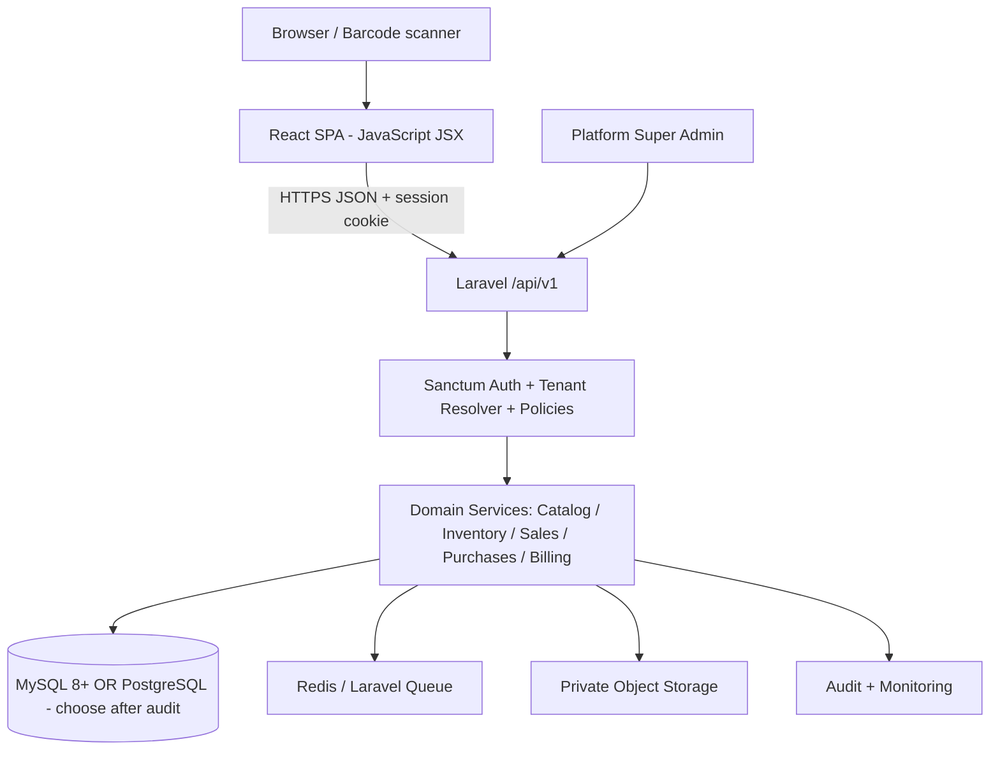

# Universal Retail POS SaaS — React (JavaScript) + Laravel Implementation Blueprint

**Document version:** 1.0  
**Prepared:** 2026-10-19  
**Source of current-state facts:** User-supplied `AGENT(1).md`, reviewed 2026-10-19  
**Purpose:** A practical, agent-ready, step-by-step specification for transforming the existing school-uniform Laravel/Blade POS into a general-purpose, multi-tenant retail SaaS using **React with JavaScript (NOT TypeScript)** and Laravel REST APIs, **without losing existing business data**.

> **READ THIS FIRST — FACTS VS PROPOSALS**
> - **Existing behavior** in sections 1 and 12 is based on `AGENT(1).md`. That document analyzed source/migrations, **not the live database**. It reports 45 migrations and 27 declared tables; current Composer autoload is missing and Artisan cannot currently boot. Do not assume the deployed schema matches the guide.
> - **Target design** in sections 2–11 is a **proposed architecture**, not code that already exists. Table names, API routes, roles, accounting treatment, and package choices must be validated against actual business needs and current repository before implementation.
> - **No destructive migration:** Do not delete or rename legacy tables, regenerate an established `APP_KEY`, run `migrate:fresh`, `migrate:refresh`, or run non-idempotent legacy seeders on a populated database.
> - **Deliver incrementally:** One tested milestone at a time; maintain legacy functionality until the replacement is reconciled and signed off.

---

## 0. Outcomes, scope and non-goals

### Outcomes
1. Replace active Blade/jQuery admin screens with a React SPA written in **`.js` / `.jsx`**.
2. Keep Laravel as the backend and expose versioned JSON REST APIs.
3. Turn school/product/size-specific stock into a **universal product + variant + location** model.
4. Support multiple independent tenant businesses, users, branches, registers and inventory locations.
5. Provide reliable catalog, stock, purchasing, sales, payments, returns, cash closing, reporting and SaaS subscriptions.
6. Preserve original order amounts, records, legacy IDs, customer history, stock position and accounting evidence.
7. Establish repeatable tests, deployments, backups and rollback/cutover procedures.

### MVP (first commercial release)
Tenant onboarding; memberships/RBAC; branches and locations; generic products/variants/units/barcodes; stock ledger; suppliers and purchase receipts; POS checkout; customers; payments; returns/refunds; cash shifts; basic expenses; reports; SaaS plans/subscriptions; audit logs; import/export; backup/restore verification.

### Later releases
E-commerce storefront, complex promotions/loyalty, fully integrated double-entry accounting, offline-first POS, advanced demand forecasting, manufacturing, pharmacy regulatory workflows, international tax/e-invoicing integrations. **Design extensibility now, implement later.**

### Decisions to confirm before coding
- Production DB engine/version and actual schema; this guide **does not verify them**.
- First tenant's physical inventory locations and whether school-specific items are distinct SKUs or shared products with price lists.
- Currency, tax jurisdiction, rounding, receipt format and refund policy.
- SaaS payment provider, billing interval, grace period and tenant suspension behavior.
- Whether customers can buy on credit; whether negative inventory is ever permitted (default: no).
- Deployment domain model (recommended: `app.example.com` React + `api.example.com` Laravel, or same-origin reverse proxy).
- Whether POS must work offline (recommended: **not** in MVP).

---

## 1. Current repository: verified from supplied guide

| Area | Documented current state | Implication |
|---|---|---|
| Backend | Laravel 11; lock file Laravel 11.8.0; PHP ^8.2 | Keep existing codebase, check upgrade compatibility later |
| UI | Blade, AdminLTE, Bootstrap, jQuery, Select2, inline AJAX; static storefront | Build React SPA; migrate screen by screen |
| APIs | No separate `routes/api.php` or SPA | Create versioned JSON API and contracts |
| DB | SQLite default config, MySQL-specific dashboard SQL; live DB uninspected | Verify production engine first |
| Inventory | `stocks` identified by `school_id + product_id + size_id`, integer quantity, base/sale price, product_code | Build generic variants and stock movement ledger |
| Pricing | School percentage margin, then order discount; GST stored but not included | Preserve historical calculations; introduce configurable future pricing |
| Sales | `orders` + `order_items`; customer linked via `orders.user_id` into shared `users` | Separate customers from authenticating staff |
| Returns | `order_items.returned` counter and stock increment; legacy `returns` tables not populated by current flow | Create transactional returns and refunds |
| Accounting | `ledgers` polymorphic, `ledger` legacy, `daily_account`; inconsistent conventions | Preserve raw history; reconcile before new ledger |
| Security | Fixed role IDs, permission IDs stored as JSON, missing hidden fields, GET destructive routes | Replace with scoped permission keys/policies |
| Tests | Two scaffold tests; original run 1 passed/1 failed; current vendor autoload absent | Restore dependencies and build business test suite |
| Routes | Some missing controllers/methods | Fix/retire safely; do not blindly expose via API |

### Known high-risk existing behavior to correct
- No reliable server-side `requested_qty <= available_qty` check or row locking; oversell possible.
- Return validation/transaction gaps; cancellation can restore stock twice; deleting orders does not restock.
- Client-provided received/remaining figures and some totals are not authoritative.
- Sales reports, returns, dashboard and daily account do not share consistent net/discount logic.
- Full `User` models can leak sensitive fields via customer suggestion endpoints.
- Current return creation does not persist return timestamp/refund; **do not fabricate these historically**.
- `vendor/autoload.php` absent as of source review; do `composer install` before Artisan. Existing `.env` must be preserved.

---

## 2. Target architecture and technology stack



### Backend
- **Laravel:** keep installed major version initially; PHP >= 8.2; Composer.
- **Structure:** modular monolith, controllers thin; Form Requests for validation, API Resources for output, service/action classes for business operations, Policies for authorization, Events/Jobs for asynchronous work.
- **Authentication:** Laravel Sanctum SPA **cookie/session authentication** with CSRF, HTTPS, same-site domain configuration and session rotation. Do not store long-lived bearer tokens in localStorage. If cross-site deployment is unavoidable, explicitly design cookie/CORS rules and test them.
- **Tenancy:** application-level shared database with `tenant_id`; trusted active-tenant resolution from verified domain or membership, never arbitrary request body ID; tenant-scoped queries and composite tenant-aware constraints for critical relations.
- **Queues:** Redis + queue worker recommended for notifications, imports, exports and webhook processing; database queue acceptable for initial deployment if sized appropriately.
- **Files:** private tenant-scoped object storage with signed/authorized downloads.
- **DB:** choose **one** production engine after live audit. MySQL 8+ or PostgreSQL are both viable; migration SQL/constraints must be written and tested for the selected engine. No automatic conversion from SQLite assumed.
- **Money:** choose consistent DECIMAL(19,4) intermediate monetary columns or integer minor units; never binary float. Currency-specific rounding and totals defined centrally. Quantities DECIMAL(18,4); enforce integer quantity for serialized goods.

### Frontend — JavaScript only
- **React 18+ with Vite**; **JavaScript `.jsx` / `.js` only; no TypeScript, `.ts`, `.tsx`, `tsconfig`, or TS-specific libraries.**
- React Router for routing; TanStack Query for server state/cache; Axios (or native fetch) for API; React Hook Form + Zod for validation (Zod works in JS); Zustand or Context for small client-only state.
- UI: choose one consistent component system (e.g. Tailwind CSS + accessible component primitives). Keep POS keyboard- and scanner-friendly; test small screens and desktop.
- Charts: Recharts or Chart.js; printing: server-generated PDF/HTML or browser print with exact invoice snapshots.
- Accessibility: focus management, keyboard shortcuts, visible errors, contrast, labels.
- **Never calculate authoritative prices or available stock only in React.** UI previews are estimates until confirmed by backend.

### Recommended repo layout (monorepo)
```text
project-root/
  backend/                      # Existing Laravel application, migrated gradually
    app/
      Domain/
        Tenancy/ Identity/ Catalog/ Inventory/ Purchasing/
        Sales/ Returns/ Payments/ Finance/ Subscriptions/ Reporting/
      Http/Controllers/Api/V1/
      Http/Requests/Api/V1/
      Http/Resources/
      Policies/
    database/migrations/
    database/seeders/
    routes/api.php
    routes/web.php              # Keep legacy Blade routes during transition
    tests/Feature/ tests/Unit/
  frontend/
    index.html
    package.json
    vite.config.js
    src/
      main.jsx
      app/App.jsx
      app/router.jsx
      api/client.js
      api/endpoints.js
      auth/AuthProvider.jsx
      tenancy/TenantProvider.jsx
      layouts/
      components/
      features/
        dashboard/ catalog/ inventory/ purchasing/ pos/
        sales/ returns/ customers/ suppliers/ cash/ reports/
        settings/ team/ subscriptions/
      hooks/ utils/ styles/
  docs/
    AGENT.md
    UNIVERSAL_POS_REACT_JS_LARAVEL_IMPLEMENTATION_BLUEPRINT.md
    decisions/
    migration-mappings/
    api-contracts/
```

> **Migration reality:** Your Laravel project is currently at repository root. The `backend/` move is optional and should occur only after build/deploy scripts are updated. A safer first step is to keep Laravel at root and add `frontend/`; move directories later if beneficial.

---

## 3. Multi-tenant SaaS business rules

1. **Tenant = subscribing business**, branch = store, location = sellable stockroom/warehouse; one tenant can have many branches/locations.
2. One human login (`users`) may belong to multiple tenants via `tenant_memberships`; retail customers are stored separately in `customers`.
3. `tenant_id` is required for all tenant-owned rows (except platform/global lookup rows explicitly documented); branch/location IDs must belong to the same tenant.
4. Platform administrators have separate routes/roles. No implicit superuser bypass in tenant business APIs.
5. Use policy checks and `tenant_id` filters in reads, updates, joins, exports, storage, jobs and background events.
6. Use tenant-aware unique indexes: `(tenant_id, sku)`, `(tenant_id, invoice_number)`, `(tenant_id, branch_code)`.
7. Subscription entitlements gate modules and limits; tenant suspension should block **new mutations**, preserve data, and allow explicitly authorized read/export access under the agreed policy.
8. Audit all tenant switching, staff changes, discounts, stock adjustments, returns, payment reversals and billing events.
9. Tenant lifecycle: `trialing`, `active`, `past_due`, `suspended`, `cancelled`, `archived` (define transitions and grace rules).
10. **MVP isolation model:** shared schema with tenant IDs. Later dedicated database support is a separate architectural project.

### Roles (suggested)
- Platform: `platform_owner`, `platform_support` (restricted, audited impersonation only if implemented).
- Tenant: `owner`, `admin`, `manager`, `cashier`, `inventory_clerk`, `accountant`, `viewer`.
- Permission keys, not numeric IDs: `products.view`, `products.manage`, `inventory.adjust`, `purchases.approve`, `sales.create`, `sales.refund`, `cash.close`, `reports.view`, `team.manage`, `billing.manage`.
- Branch-specific role assignments optional; cashier access limited to assigned branches/registers.

---

## 4. Full proposed logical database schema

**Legend:** `PK` primary key; `FK` foreign key; `UQ` unique; `IDX` indexed; `?` nullable; `T` = `tenant_id` FK required on tenant-owned tables. All business tables normally have `id BIGINT PK`, `created_at`, `updated_at` and optional `deleted_at` only where explicitly appropriate. Define exact precision, timezone handling, enum/check constraints, cascade/restrict behavior and foreign keys in migrations. **No `ON DELETE CASCADE` on posted financial transactions.**

### 4.1 Platform, tenancy, identity and permissions
| Table | Essential columns | Keys and invariants |
|---|---|---|
| `tenants` | id, name, slug, status, timezone, currency_code, tax_registration_no?, created_at | UQ(slug) |
| `tenant_domains` | id, tenant_id, hostname, verified_at?, is_primary | UQ(hostname), FK tenant |
| `tenant_settings` | id, T, setting_key, value_json | UQ(T,setting_key) |
| `users` | id, name, email, password_hash, email_verified_at?, status, last_login_at? | UQ(email); authentication users only |
| `tenant_memberships` | id, T, user_id, status, invited_by?, joined_at? | UQ(T,user_id) |
| `roles` | id, T?, code, name, is_system | UQ(T,code); global templates nullable T |
| `permissions` | id, code, module, description? | UQ(code) |
| `role_permissions` | role_id, permission_id | UQ(role_id,permission_id) |
| `membership_roles` | id, T, membership_id, role_id, branch_id? | composite uniqueness; same-tenant checks |
| `branches` | id, T, code, name, address_json?, phone?, status | UQ(T,code) |
| `locations` | id, T, branch_id?, code, name, type, status | UQ(T,code); type store/warehouse/quarantine/in_transit |
| `cash_registers` | id, T, branch_id, code, name, active | UQ(T,branch_id,code) |
| `audit_logs` | id, T?, actor_user_id?, action, subject_type, subject_id, before_json?, after_json?, ip?, request_id?, occurred_at | append-only, indexed tenant/date |
| `tenant_invitations` | id, T, email, token_hash, role_id, expires_at, accepted_at? | single-use, hashed tokens |

**Authentication note:** Keep Laravel `password_reset_tokens`, `sessions`, cache/jobs infrastructure as framework-managed tables. Never expose `password_hash` or session tokens through API Resources.

### 4.2 SaaS subscriptions and billing (platform-level, not retail receipts)
| Table | Essential columns | Keys and invariants |
|---|---|---|
| `plans` | id, code, name, status, trial_days | UQ(code) |
| `plan_prices` | id, plan_id, currency_code, interval, amount | UQ(plan_id,currency_code,interval) |
| `features` | id, code, description | UQ(code) |
| `plan_entitlements` | id, plan_id, feature_id, enabled, limit_value? | UQ(plan_id,feature_id) |
| `tenant_subscriptions` | id, T, plan_price_id, provider?, provider_subscription_id?, status, trial_ends_at?, current_period_starts_at?, current_period_ends_at?, cancel_at? | UQ(provider,provider_subscription_id) when present |
| `saas_invoices` | id, T, subscription_id, invoice_no, currency_code, subtotal, tax_total, total, status, due_at? | UQ(invoice_no) or scoped per policy |
| `saas_invoice_payments` | id, T, saas_invoice_id, provider, external_reference, amount, currency_code, status, paid_at? | UQ(provider,external_reference) |
| `billing_webhook_events` | id, provider, provider_event_id, payload_json, status, processed_at?, error? | UQ(provider,provider_event_id) |
| `tenant_feature_usage` | id, T, feature_id, period_start, period_end, quantity | UQ(T,feature_id,period_start) |

### 4.3 Universal catalog, attributes, prices and tax
| Table | Essential columns | Keys and invariants |
|---|---|---|
| `categories` | id, T, parent_id?, name, slug, active | UQ(T,parent_id,slug) with DB-specific null strategy |
| `brands` | id, T, name, code?, active | UQ(T,code) where present |
| `units` | id, T?, code, name, quantity_precision | global templates or tenant-owned; clear uniqueness |
| `unit_conversions` | id, T, from_unit_id, to_unit_id, multiplier | conversion must be positive |
| `products` | id, T, category_id?, brand_id?, name, description?, product_type, track_inventory, tax_class_id?, active | type simple/variable/bundle/service/digital |
| `product_variants` | id, T, product_id, sku, name?, base_unit_id, barcode_primary?, default_cost, default_price, active, tracking_mode | UQ(T,sku); one variant even for simple products |
| `attributes` | id, T, code, name | UQ(T,code) |
| `attribute_values` | id, T, attribute_id, value, sort_order | UQ(T,attribute_id,value) |
| `variant_attribute_values` | id, T, variant_id, attribute_value_id | UQ(variant_id,attribute_value_id); enforce one value per attribute per variant |
| `product_barcodes` | id, T, variant_id, barcode, symbology?, unit_id? | UQ(T,barcode) |
| `product_images` | id, T, product_id, variant_id?, storage_path, sort_order | private/authorized upload |
| `bundles` | id, T, sellable_variant_id, price_mode | UQ(T,sellable_variant_id) |
| `bundle_components` | id, T, bundle_id, component_variant_id, quantity | quantity > 0; no cycles |
| `price_lists` | id, T, name, currency_code, priority, active, valid_from?, valid_to? | price-list rules |
| `price_list_items` | id, T, price_list_id, variant_id, unit_price, min_qty | scoped UQ as defined |
| `tax_classes` | id, T, code, name | UQ(T,code) |
| `tax_rates` | id, T, tax_class_id, jurisdiction_code?, rate_percent, valid_from, valid_to? | prevent unintended overlaps |
| `discount_rules` | id, T, code?, type, value, starts_at?, ends_at?, active, approval_required | future configurable promotions |

**Variant identity:** size/color are *optional attributes*, never mandatory. Weighted goods use decimal quantities and units; serialized goods need individual serials; service products do not deduct physical stock. `default_cost` is a planning/current value, not historical COGS.

### 4.4 Inventory and purchasing
| Table | Essential columns | Keys and invariants |
|---|---|---|
| `inventory_balances` | id, T, location_id, variant_id, on_hand, reserved, version | UQ(T,location_id,variant_id); available=on_hand-reserved |
| `stock_movements` | id, T, location_id, variant_id, movement_type, quantity_delta, reference_type, reference_id, source_event_id, occurred_at, actor_id?, unit_cost_snapshot? | append-only; UQ(T,source_event_id) for idempotent postings |
| `stock_reservations` | id, T, location_id, variant_id, quantity, reference_type, reference_id, expires_at?, status | reserve/release atomically |
| `stock_adjustments` | id, T, location_id, adjustment_no, reason, status, created_by, approved_by?, posted_at? | UQ(T,adjustment_no) |
| `stock_adjustment_items` | id, T, adjustment_id, variant_id, counted_qty?, quantity_delta, reason? | no direct mutation after posting |
| `stock_counts` | id, T, location_id, count_no, status, started_at, posted_at? | UQ(T,count_no) |
| `stock_count_items` | id, T, count_id, variant_id, expected_qty, counted_qty, variance_qty | unique variant per count |
| `suppliers` | id, T, supplier_code?, name, email?, phone?, address_json?, payment_terms_days, active | UQ(T,supplier_code) where present |
| `purchase_orders` | id, T, supplier_id, destination_location_id, po_number, status, ordered_at?, expected_at?, currency_code, subtotal, tax_total, total, created_by, approved_by? | UQ(T,po_number) |
| `purchase_order_items` | id, T, purchase_order_id, variant_id, ordered_qty, received_qty, unit_cost, tax_amount, line_total | received_qty <= ordered_qty except approved overreceipt |
| `goods_receipts` | id, T, supplier_id, purchase_order_id?, location_id, receipt_no, status, received_at?, posted_at? | UQ(T,receipt_no) |
| `goods_receipt_items` | id, T, goods_receipt_id, purchase_order_item_id?, variant_id, accepted_qty, rejected_qty, unit_cost, batch_id? | posted receipt creates stock movement |
| `purchase_returns` | id, T, supplier_id, location_id, return_no, status, posted_at? | UQ(T,return_no) |
| `purchase_return_items` | id, T, purchase_return_id, variant_id, qty, unit_cost | supplier return decreases stock |
| `stock_transfers` | id, T, source_location_id, destination_location_id, transfer_no, status, shipped_at?, received_at? | UQ(T,transfer_no); source != destination |
| `stock_transfer_items` | id, T, stock_transfer_id, variant_id, requested_qty, shipped_qty, received_qty | in-transit accounting |
| `inventory_batches` | id, T, variant_id, batch_no, expiry_date?, received_at? | optional lot/expiry module |
| `inventory_serials` | id, T, variant_id, serial_no, location_id?, status, source_receipt_item_id? | UQ(T,serial_no); optional serialized module |

**Inventory posting contract:** All changes go through one `InventoryPostingService`. Within a DB transaction: resolve tenant/location/variant; lock balance rows in deterministic order; check availability; insert unique source-event movement; update balance; commit; dispatch notifications **after commit**. Transfers post dispatch and receipt separately. Never mutate movement rows; post compensating reversals.

### 4.5 Retail customers, sales, payments and returns
| Table | Essential columns | Keys and invariants |
|---|---|---|
| `customers` | id, T, customer_code?, name, phone?, email?, active, notes? | optional identifiers; avoid forced deduplication |
| `customer_addresses` | id, T, customer_id, label?, address_json, is_default | scoped FK |
| `sales` | id, T, branch_id, location_id, register_id?, cash_session_id?, customer_id?, cashier_membership_id, invoice_no, channel, sale_status, payment_status, fulfillment_status, currency_code, subtotal, discount_total, tax_total, grand_total, total_refunded, sold_at, legacy_source_id? | UQ(T,invoice_no); posted amounts immutable |
| `sale_items` | id, T, sale_id, variant_id?, sku_snapshot, name_snapshot, unit_snapshot, qty, unit_price, unit_cost_snapshot?, discount_total, tax_total, line_total, returned_qty | retain snapshots even if catalog changes |
| `payment_methods` | id, T, code, name, method_type, active | UQ(T,code) |
| `sale_payments` | id, T, sale_id, method_id, amount, currency_code, status, gateway_reference?, idempotency_key?, captured_at?, cash_session_id? | unique gateway reference where present |
| `sale_returns` | id, T, original_sale_id, return_no, status, reason_code?, requested_by, approved_by?, posted_at? | UQ(T,return_no) |
| `sale_return_items` | id, T, sale_return_id, sale_item_id, qty, disposition, refund_amount, tax_refund, discount_refund | aggregate returned qty <= sold qty |
| `refunds` | id, T, sale_return_id, payment_method_id, amount, status, gateway_reference?, refunded_at? | no fabricated legacy refunds |
| `exchange_links` | id, T, sale_return_id, replacement_sale_id, adjustment_amount | exchange is return + new sale |
| `held_carts` | id, T, branch_id, cashier_membership_id, cart_json, expires_at?, status | drafts, not posted sales |
| `cash_sessions` | id, T, register_id, opened_by, opened_at, opening_cash, closed_by?, closed_at?, counted_cash?, expected_cash?, variance?, status | one open session per register |
| `cash_movements` | id, T, cash_session_id, movement_type, amount, reason, actor_id, occurred_at | signed, auditable cash in/out |
| `idempotency_records` | id, T, operation, idempotency_key, request_hash, response_code?, response_json?, expires_at | UQ(T,operation,idempotency_key) |

**Sale states:** `draft` → `pending_payment` → `completed` / `voided` (controlled transitions). Payment state separate: `unpaid`, `partial`, `paid`, `refunded`, `partially_refunded`. Fulfillment separate. External payment pending ≠ confirmed sale. Do not delete completed sales.

### 4.6 Expenses, payables/receivables and accounting
| Table | Essential columns | Keys and invariants |
|---|---|---|
| `expense_categories` | id, T, name, code | UQ(T,code) |
| `expenses` | id, T, branch_id?, category_id, amount, currency_code, expense_date, payee?, payment_account_id?, status, approved_by? | posted expenses immutable/reversible |
| `financial_accounts` | id, T, code, name, type, currency_code, active | UQ(T,code) |
| `customer_receivables` | id, T, customer_id, sale_id, original_amount, outstanding_amount, due_date?, status | derive from verified posted activity |
| `supplier_payables` | id, T, supplier_id, purchase_order_id?, invoice_reference?, original_amount, outstanding_amount, due_date?, status | verify goods/invoice basis |
| `financial_settlements` | id, T, source_type, source_id, financial_account_id, amount, posted_at, reference | allocates receipts/payments |
| `chart_of_accounts` | id, T, account_code, name, account_type, parent_id?, active | UQ(T,account_code) |
| `journal_entries` | id, T, journal_no, source_type, source_id, posting_date, status, posted_at? | UQ(T,journal_no), UQ(T,source_type,source_id) if one journal per source |
| `journal_lines` | id, T, journal_entry_id, account_id, debit, credit, description? | debits=credits at posting; nonnegative |
| `accounting_periods` | id, T, starts_on, ends_on, status, closed_by? | prevent edits to closed periods |

**Scope note:** Full general ledger and cost-layer accounting are a later milestone. MVP reports may use explicitly labeled gross margin estimates; do **not** call them final net profit. Choose FIFO or weighted-average inventory valuation and specify returns/discount/tax/landed-cost behavior before implementing COGS. A verified ledger must use double entry and balanced journals.

### 4.7 Reports, integrations, operations and migration
| Table | Essential columns | Keys and invariants |
|---|---|---|
| `notifications` | id, T, user_id?, channel, event_code, payload_json, status, sent_at? | tenant scoped |
| `notification_templates` | id, T, event_code, channel, body_template, active | scoped UQ |
| `import_batches` | id, T, type, storage_path, status, totals_json, error_report_path?, initiated_by | track row errors |
| `export_jobs` | id, T, type, filters_json, status, file_path?, expires_at?, initiated_by | authorize downloads |
| `webhook_endpoints` | id, T, url, subscribed_events_json, secret_encrypted, active | SSRF prevention |
| `webhook_deliveries` | id, T, endpoint_id, event_id, status, attempt_count, last_attempt_at? | retry/idempotency |
| `integration_connections` | id, T, provider, credential_ref, status | encrypted secrets |
| `legacy_record_mappings` | id, T, source_table, source_pk, target_table, target_pk, migration_batch_id, mapping_json? | UQ(T,source_table,source_pk,target_table); traceability |
| `migration_batches` | id, T, batch_code, source_snapshot_at, started_at, finished_at?, status, reconciliation_json? | idempotent runs |
| `migration_exceptions` | id, T, migration_batch_id, source_table, source_pk, issue_code, details_json, resolution_status | do not silently guess |
| `legacy_financial_snapshots` | id, T, source_table, source_pk, original_json, source_checksum, imported_at | read-only provenance |

### 4.8 Constraints and index checklist
- Tenant-owned foreign keys should prevent referencing a different tenant's row. Prefer `(tenant_id,id)` parent candidate keys and composite FKs `(tenant_id,parent_id)` for critical joins where DB permits; otherwise enforce in services **and tests**.
- Unique: `(tenant_id,sku)`, `(tenant_id,barcode)`, `(tenant_id,location_id,variant_id)`, `(tenant_id,invoice_no)`, `(tenant_id,po_number)`, `(tenant_id,return_no)`.
- Index: `(tenant_id,created_at)`, `(tenant_id,status,created_at)`, `(tenant_id,branch_id,sold_at)`, `(tenant_id,variant_id,occurred_at)`.
- Use CHECK constraints for `qty > 0` on posted lines, `on_hand >= 0` unless explicit allowed policy, `reserved >= 0`, `debit >= 0`, `credit >= 0`, and appropriate posted state rules (engine-dependent).
- Nullable unique indexes differ between MySQL and PostgreSQL. For optional barcodes, prefer separate `product_barcodes` rows; document duplicate/NULL strategy.
- Avoid DB enum columns when new product types/states may evolve; use validated string codes and clear transitions.
- Historical financial records should not cascade-delete when customers/products are archived; snapshot labels and amounts.
- Audit and stock movements should be append-only at the application permission level; enforce DB privileges as feasible.

---

## 5. API design: versioned JSON contract

**Base:** `/api/v1`. All tenant endpoints require `auth:sanctum`, active membership, `ResolveTenant`, and policy/permission middleware. React should not send trusted `tenant_id` for authorization; selected tenant context can be conveyed by validated subdomain or membership-backed header/path. Prefer one approach consistently.

**Standard response:**
```json
{
  "data": { "id": 123, "name": "Example" },
  "meta": { "request_id": "req_..." }
}
```
**Validation error:** HTTP 422 with `{ "message": "Validation failed", "errors": { "field": ["..."] } }`. Use 401 unauthenticated, 403 forbidden, 404 tenant-scoped not found, 409 conflict (stock/version/idempotency), 429 rate limit.

### 5.1 Authentication and tenant selection
| Method | Route | Purpose |
|---|---|---|
| GET | `/sanctum/csrf-cookie` | Sanctum SPA CSRF setup (framework route) |
| POST | `/api/v1/auth/login` | Login, rotate session |
| POST | `/api/v1/auth/logout` | Logout, invalidate session/token |
| GET | `/api/v1/auth/me` | Current user and memberships |
| GET | `/api/v1/tenants` | Accessible tenant list |
| POST | `/api/v1/tenants` | Create tenant/onboarding |
| POST | `/api/v1/tenants/{tenant}/activate` | Verify membership and establish active context |
| GET | `/api/v1/context` | Current tenant, branch, entitlements, permissions |

### 5.2 CRUD and operational endpoints
| Module | Core routes | Important behavior |
|---|---|---|
| Catalog | `GET/POST /products`, `GET/PATCH /products/{id}`, `/products/{id}/variants`, `/categories`, `/brands`, `/units`, `/attributes` | pagination/search, unique SKU |
| Inventory | `GET /inventory/balances`, `GET /inventory/movements`, `POST /inventory/adjustments`, `POST /inventory/counts`, `POST /inventory/counts/{id}/post` | posting, approvals, lock |
| Suppliers | `GET/POST /suppliers`, `GET/PATCH /suppliers/{id}` | tenant scope |
| Purchasing | `GET/POST /purchase-orders`, `POST /purchase-orders/{id}/approve`, `POST /goods-receipts`, `POST /goods-receipts/{id}/post` | partial receipts |
| Sales | `GET /sales`, `POST /sales`, `GET /sales/{id}`, `POST /sales/{id}/void`, `GET /sales/{id}/receipt` | idempotent checkout |
| POS | `GET /pos/search?q=`, `GET /pos/scan/{barcode}`, `POST /pos/quote`, `POST /pos/checkout` | server quote, server finalize |
| Returns | `GET/POST /sale-returns`, `POST /sale-returns/{id}/approve`, `POST /sale-returns/{id}/post`, `POST /refunds` | no overreturn |
| Payments | `GET /sales/{id}/payments`, `POST /sales/{id}/payments` | split and partial |
| Cash | `POST /cash-sessions/open`, `POST /cash-sessions/{id}/cash-movements`, `POST /cash-sessions/{id}/close` | expected vs counted |
| Customers | `GET/POST /customers`, `GET/PATCH /customers/{id}`, `GET /customers/{id}/history` | safe autocomplete DTO |
| Reports | `GET /reports/sales`, `/reports/inventory`, `/reports/payments`, `/reports/returns`, `/reports/summary` | consistent date/time semantics |
| Tenant settings | `/settings`, `/branches`, `/locations`, `/team`, `/roles`, `/permissions` | policy enforcement |
| SaaS | `GET /plans`, `GET /subscription`, `POST /subscription/checkout`, `POST /subscription/cancel` | gateway integration |
| Billing webhooks | `POST /webhooks/billing/{provider}` | signature verified; **not** tenant-header auth |

### 5.3 Example checkout request
```json
{
  "branch_id": 1,
  "location_id": 1,
  "register_id": 1,
  "customer_id": 25,
  "items": [
    { "variant_id": 1001, "quantity": "2.0000", "discount_rule_id": null },
    { "variant_id": 1002, "quantity": "0.7500", "discount_rule_id": null }
  ],
  "payments": [
    { "method_code": "cash", "amount": "2500.00" }
  ],
  "note": "Walk-in purchase"
}
```
Headers: `Idempotency-Key: <unique-per-checkout>`; authenticated tenant context. **No client-submitted authoritative unit price, tax, grand total, remaining balance, or stock.** Backend recalculates and returns final invoice/payment status. If totals changed since quote, return a structured 409 requiring cashier confirmation.

### 5.4 API implementation checklist
- Request validation + authorization + tenant-scoped model binding.
- API Resources whitelist output fields; never serialize full `User` model for autocomplete.
- Pagination, filters, sorts allowlisted, consistent ISO timestamps in UTC, localized display in React.
- Money serialized as **decimal strings**, not JSON floats.
- Versioned contract tests; OpenAPI spec generated/maintained for frontend handoff.
- Idempotency for checkout, refund, goods-receipt posting, billing webhooks.
- External side effects via after-commit jobs/outbox strategy; no email/webhook in open DB transaction.

---

## 6. React JavaScript application: pages, components, state and routes

### 6.1 Frontend navigation
| Route | Screen | API dependency |
|---|---|---|
| `/login` | Staff login | auth |
| `/select-business` | Tenant switcher | memberships |
| `/onboarding` | Business setup | tenant + subscription |
| `/app/dashboard` | KPIs | reports |
| `/app/pos` | Barcode POS, cart, checkout | catalog, inventory, pricing, sales |
| `/app/sales` | Sales list/details/invoice | sales |
| `/app/returns` | Returns/refunds/exchanges | returns |
| `/app/products` | Products and variants | catalog |
| `/app/categories` | Categories/brands/units/attributes | catalog |
| `/app/inventory` | Stock balances and movements | inventory |
| `/app/stock-counts` | Count/adjust | inventory |
| `/app/purchases` | POs and receipts | purchasing |
| `/app/suppliers` | Suppliers | suppliers |
| `/app/customers` | Customers/history | customers |
| `/app/cash-register` | Open/close shift | cash |
| `/app/expenses` | Expenses | finance |
| `/app/reports` | Sales/stock/returns/payments | reporting |
| `/app/team` | Users/roles/permissions | identity |
| `/app/branches` | Branches/warehouses | tenancy |
| `/app/settings` | Tax, currency, receipt, business | settings |
| `/app/billing` | SaaS plan and invoices | subscription |
| `/platform/*` | Platform operator only | separate platform policies |

### 6.2 POS React component breakdown
```text
features/pos/
  pages/PosPage.jsx
  components/ProductSearch.jsx
  components/BarcodeInput.jsx
  components/CartTable.jsx
  components/QuantityEditor.jsx
  components/CustomerSelector.jsx
  components/DiscountPanel.jsx
  components/PaymentModal.jsx
  components/CheckoutSummary.jsx
  components/ReceiptPreview.jsx
  hooks/usePosCart.js
  api/posApi.js
  utils/formatMoney.js
```

### 6.3 State rules
- **TanStack Query:** server resources (products, stock, customers, permissions, reports). Include active tenant ID in query keys and clear/invalidate on tenant switch.
- **Local Zustand/Context:** ephemeral cart, UI state, selected register; never treat as final inventory or final price.
- **React Hook Form + Zod JS:** client feedback; backend remains authoritative.
- **Axios:** one `api/client.js` with `withCredentials: true`, base URL from `import.meta.env.VITE_API_URL`, CSRF initialization and 401/403 handling. Never log sensitive request bodies.
- Route guards for UX; Laravel policies are the real security boundary.
- Avoid fetching the entire product/stock database at POS startup; use paginated search and barcode lookup.

### 6.4 Sample JS-only bootstrap commands (for a NEW frontend directory)
```bash
npm create vite@latest frontend -- --template react
cd frontend
npm install
npm install react-router-dom axios @tanstack/react-query zustand react-hook-form zod @hookform/resolvers
npm run dev
```

**Caution:** Verify Node/npm compatibility and current package versions in your environment. Do not run the scaffold over an existing `frontend/` folder. These commands create a React **JavaScript** project, not TypeScript.

---

## 7. Business workflows and domain service contracts

### 7.1 Tenant onboarding
Register/login → verify identity → create tenant + owner membership → choose trial/plan → default branch/location/register → configure currency/tax → import catalog → first sale. Provisioning must be idempotent; retries must not duplicate owner, branch or plan.

### 7.2 Catalog
Create category/brand/unit → create product → create one or many variants → assign SKU/barcode → set tax/price → activate. Creating a product does **not** increase stock. For simple product create one default variant; for clothing add size/color attributes; for grocery use weight/units; for services disable inventory tracking.

### 7.3 Purchasing
Draft PO → approve → supplier delivers → create goods receipt → inspect accepted/rejected quantities → post receipt → inventory increases and purchase obligation recorded → record supplier settlement. Support partial receipts and prevent double posting.

### 7.4 Inventory movement
All inventory changes through one service: opening stock, goods receipt, sale, return, transfer dispatch/receipt, adjustment, write-off. Each movement stores tenant, location, variant, signed delta, unique event reference, actor and timestamp. Do not edit posted movement rows.

### 7.5 POS sale
Open cash shift → scan/search → select variants/quantities → server quote → collect/confirm payments → atomic sale/stock posting → print receipt. Concurrency lock, idempotency and stock checks mandatory. Split payments sum to amount due; credit sales allowed only under explicit policy.

### 7.6 Return/exchange
Find original sale → select original sale lines → validate cumulative returns <= sold qty → assess resellable/damaged → approve → post return and inventory disposition → issue refund or exchange-linked new sale. Cancellation and returns must not both restock the same units.

### 7.7 Daily cash closing
Open shift with opening cash → link cash payments/refunds/cash-in/out → calculate expected drawer cash → count physical cash → record variance → supervisor approve if needed → lock shift. Card/bank receipts are not drawer cash.

### 7.8 SaaS subscription
Tenant selects plan → create provider checkout → verify signed webhook → dedupe provider event → update subscription/entitlements → send notification after commit. Past-due policy explicit; no automatic deletion of business records.

---

## 8. Step-by-step development roadmap with deliverables and acceptance gates

### Phase 0 — Source, live DB and recovery audit (DO FIRST)
**Tasks**
1. Preserve git working tree and `.env`; copy `AGENT(1).md` into `docs/AGENT.md` as a current-state reference.
2. Run `composer install` to restore missing `vendor/autoload.php` using existing lockfile; do **not** regenerate `APP_KEY`.
3. On **isolated staging**, run `php artisan --version`, `route:list`, `migrate:status`, `php artisan test`; document failures; fix missing controllers only when needed for migration/tests.
4. Identify actual DB driver, server version, live table DDL, row counts, FKs, indexes, orphaned records, duplicate school/product/size combos and duplicate product codes.
5. Export encrypted DB backup + files + deployment config; restore to staging and run integrity checks.
6. Record baseline counts, inventory totals per stock ID, historical sales/return counters, dealer ledgers, daily-account totals, expenses, customer records.
7. Create `docs/decisions/ADR-001-db-engine.md`, migration mapping spreadsheet/CSV, test fixtures, and rollback plan.
**Gate:** Backup restored; schema documented; baseline checks signed off; no production writes by migration scripts.

### Phase 1 — API foundation + React JavaScript shell
**Tasks**
1. Add `frontend/` with Vite React JS (`.jsx`, `.js`) and standard routing/layout.
2. Add `routes/api.php` / `/api/v1`, JSON error handling, API Resources, Form Requests, rate limits.
3. Configure Sanctum SPA auth, CORS, session cookies, CSRF and secure logout.
4. Implement login, current user, tenant list/switch context, error screens and permissions-aware menu.
5. Add backend PHPUnit feature tests + React component/API mocking tests (Vitest + React Testing Library, JS only).
6. Deploy frontend and backend in staging behind HTTPS/reverse proxy.
**Gate:** Login/logout works, CSRF and CORS tested, no TypeScript files, API contracts documented.

### Phase 2 — SaaS tenant foundation
**Tasks**
1. Add `tenants`, memberships, branches, locations, scoped roles/permissions and policies.
2. Create **one legacy tenant** for existing Best Uniform business.
3. Add nullable `tenant_id` to existing business tables in additive migrations; backfill verified records; then enforce constraints after reconciliation.
4. Tenant middleware, safe tenant switching, tenant-aware route binding, queue context, cache keys, storage paths.
5. Build tenant registration/onboarding and owner/team screens.
6. Add tenant A/B isolation tests for list, detail, update, export, file download, cross-tenant FK submissions.
**Gate:** Existing tenant sees its legacy records; new tenant sees none; no cross-tenant access.

### Phase 3 — Universal catalog and legacy mapping
**Tasks**
1. Create categories, brands, units, products, variants, attributes, barcodes, price/tax tables.
2. Build catalog CRUD APIs and React screens.
3. Define exact legacy mapping for each `school_id/product_id/size_id/stock_id`; preserve school context in `legacy_record_mappings`.
4. Decide shared SKU vs distinct SKU per school **with business owner approval**; no automatic merging.
5. Map legacy product/school/size labels, prices, images and enums without guessing enum meaning.
6. Reconcile every old stock row to target variant/location; create exception queue for duplicates/collisions.
**Gate:** 100% legacy stock rows mapped or documented as unresolved; no deleted history; SKU uniqueness enforced.

### Phase 4 — Inventory engine and purchasing
**Tasks**
1. Add locations, inventory balances, movement ledger, adjustments, counts, reservations and optional tracking mode.
2. Import **one opening balance** per legacy stock record/group at a documented cutover instant; do not replay historical sales against it.
3. Implement InventoryPostingService with transaction/row locks, idempotent source event and nonnegative checks.
4. Implement suppliers, purchase orders, partial goods receipts, purchase returns and basic payables.
5. Build React inventory and purchasing screens, barcode search and stock adjustment approvals.
6. Run simultaneous checkout/receipt/return tests and reconciliation.
**Gate:** Every stock change traceable; no duplicate posting/oversell; opening balances match legacy snapshot.

### Phase 5 — New POS, customers and payments
**Tasks**
1. Split authenticating staff (`users`) from retail `customers`; map legacy `orders.user_id` safely.
2. Build React POS with keyboard scanner support, search, cart, customer picker, server quote, split payments and receipt.
3. Build sale/payment tables, invoice number generator, sale service, idempotent checkout and server-side tax/discount calculations.
4. Introduce cash registers/shifts and reconcile payment methods.
5. Preserve legacy sale prices/discounts separately from new pricing engine.
6. Feature flag per branch to prevent old Blade and new React checkout both posting stock through different paths.
**Gate:** End-to-end sale, partial payment, split payment, duplicate click and concurrent sale tests pass.

### Phase 6 — Returns, exchanges and financial consistency
**Tasks**
1. Implement return/refund workflow with original sale-item references and separate posted timestamps.
2. Prevent overreturn, double cancellation, negative refund and double restock.
3. Implement cash movements, shift closing and expenses integration.
4. Rebuild report calculations from posted sales/payments/returns with clear net/gross definitions.
5. Reconcile old dealer `ledger` vs `ledgers`, daily accounts and historical balances before accounting migration.
**Gate:** Sale/return/refund/cash totals reconcile and historic unknown refund data stays marked unknown.

### Phase 7 — SaaS billing, settings and operational readiness
**Tasks**
1. Plans, prices, entitlements, subscriptions, billing invoices and signed webhook processing.
2. Owner billing UI, tenant plan limits, feature access and subscription lifecycle policies.
3. Tenant-scoped settings, receipt branding, exports/imports, audit views, alert templates.
4. Monitoring, backup jobs, restore drill, rate limiting, support workflows and security review.
**Gate:** Tenant lifecycle and payment webhook retries work; business data remains safe under suspension.

### Phase 8 — Historical migration rehearsal, cutover and launch
**Tasks**
1. Run migration on restored staging snapshot with idempotent batches and mappings.
2. Compare row counts, sum quantities, order totals, discounts, returned quantities, outstanding amounts and unresolved exceptions.
3. Conduct user acceptance testing for all primary workflows and permission roles.
4. Schedule maintenance; stop legacy writes; final consistent DB/file backup.
5. Run final incremental import, reconcile, switch traffic, monitor, keep legacy app read-only.
6. Define post-cutover rollback **without discarding new transactions**; record go/no-go and signoff.
**Gate:** All blocking discrepancies resolved; recovery process tested; launch checklist approved.

Manual acceptance pack: [257 test cases and scenarios](docs/UAT_TEST_PLAN.md), with [CSV result tracking](docs/UAT_TEST_CASES.csv). These cover Phases 0–7 and Phase 8 acceptance targets; preparation of the checklist does not mean those manual cases or the cutover have been executed.

---

## 9. Exact legacy → target data migration mapping

| Legacy table/column | Target | Transformation and preservation rule |
|---|---|---|
| `roles`, `permission`, `roles.permission` JSON | `roles`, `permissions`, `role_permissions`, `membership_roles` | Map names/IDs to stable permission codes; no reliance on old numeric IDs |
| `users` staff records | `users`, `tenant_memberships` | Keep authenticating identities; verify role and credentials; preserve password hashes if compatible |
| `users` customer-only records | `customers` | Identify using verified evidence; ambiguity goes to exception queue |
| `products` | `products` | Preserve name/image/season/gender metadata, do not guess enum meanings |
| `sizes` | `attributes`, `attribute_values`, `product_variants` | Size is optional attribute; product-specific legacy size mapping retained |
| `schools` | legacy archive/mapping; optional price groups or product metadata | Do not delete; preserve names/margins and references |
| `stocks` | `product_variants`, `inventory_balances`, `stock_movements` | Map each source stock ID; opening balance once; cost/sale price snapshots |
| `stocks.product_code` | `product_barcodes` or `legacy_record_mappings` | Preserve original even if collision; new SKU generated uniquely |
| `orders` | `sales` | Preserve original recorded total, subtotal, discount, GST field, flags, dates, source ID |
| `order_items` | `sale_items` | Preserve quantities, returned counters, prices, school margin and discounted fields as legacy snapshots |
| `order_random_items` | legacy archived lines / exception review | Active sale path does not persist; do not fabricate variants |
| `returns`, `return_items` | `sale_returns`, `sale_return_items` only where valid | Current returns use counters instead; prevent duplicate historical return import |
| `orders.received_amount`, `remaining_amount` | legacy snapshot; optionally verified payment/receivable opening balances | Not evidence of real payment method/timestamp; reconcile first |
| `orders.card_payment` | legacy flag | Not a gateway transaction; never label captured card payment |
| `business_dealers` | `suppliers`/other counterparties after classification | Verify type semantics; provider/party labels inconsistent |
| `ledgers` | legacy archive + verified opening accounting balances | Preserve morph type `App\\Models\\BussinessDealer` in historical rows |
| `ledger` (singular) | separate legacy archive | Do not combine with `ledgers` without audit |
| `daily_account` | legacy daily close snapshots | Preserve original recorded totals and date provenance |
| `expenses` | `expenses` | Preserve amount/type/date; map categories only when meaning verified |
| `settings` | `tenant_settings` | Map `low_stock_alert` and others per initial tenant |
| `logs` | legacy audit archive | Preserve original JSON text and capitalized `Name` field |
| `todolist` | optional tasks module / archive | Shared unowned tasks require ownership decision |

### Historical accounting and stock rules
1. Preserve legacy order values **as recorded**. Do not recompute historical orders with new pricing rules.
2. Store `legacy_source_id`, original JSON snapshot/checksum and mapping batch for traceability.
3. If current stock is imported as opening balance, historical sale/return imports are **report-only**, not new stock postings.
4. Existing `returned` counters lack return timestamps/refunds; do not invent them.
5. `received_amount` and `remaining_amount` are browser-submitted legacy values; do not manufacture cash/card settlements.
6. Preserve old ledgers and daily closings until reconciled; do not guess debit/credit semantics.
7. Never delete original tables during migration. Retain read-only backup/archive per agreed retention policy.

### Migration verification SQL examples (adapt to actual engine/schema)
```sql
-- Source checks, read-only, on restored staging database:
SELECT COUNT(*) AS stock_rows, SUM(quantity) AS total_units FROM stocks;
SELECT school_id, product_id, size_id, COUNT(*) AS duplicate_count
FROM stocks GROUP BY school_id, product_id, size_id HAVING COUNT(*) > 1;
SELECT product_code, COUNT(*) AS duplicate_count
FROM stocks GROUP BY product_code HAVING COUNT(*) > 1;
SELECT COUNT(*) AS orders_count, SUM(total) AS recorded_total FROM orders;
SELECT COUNT(*) AS order_items_count, SUM(quantity) AS sold_qty,
       SUM(returned) AS returned_qty FROM order_items;
```
Do not equate global sum of stock with product-level correctness. Reconcile **each legacy stock ID** to its mapped variant/location, each order to its mapped sale, and each item to its mapped sale item. Record checksum/exception reports for discrepancies.

---

## 10. Testing strategy and acceptance scenarios

### Backend automated tests (PHPUnit)
- Tenant A cannot list, show, update, delete, export, download or attach Tenant B data; ID guessing returns 404/403.
- Tenant-scoped SKU/barcode and invoice uniqueness; branch/location ownership validation.
- Concurrent sales of final item: exactly one succeeds, no negative stock.
- Repeated checkout with same idempotency key: one sale and one stock movement; same key/different payload rejected.
- Purchase receipt posted twice: one stock increase.
- Sale of weighted goods preserves decimal quantities; serialized goods require integer units/serials.
- Partial return + second return <= original qty; overreturn rejected; damaged return does not restock sellable inventory.
- Cancellation after return does not double-restock; posted financial records cannot be deleted.
- Split payments, partial payments, refund payment method and shift cash reconciliation.
- Tax/discount rounding consistency across API, invoice, reports and cash close.
- Billing webhook duplicate/out-of-order delivery and signature verification.
- Historical migration repeated twice: no duplicate rows; totals and source mappings stable.

### Frontend automated tests (Vitest + React Testing Library + JS)
- Login, tenant switch, permissions-aware navigation and unauthorized screen.
- Barcode scan adds correct variant; scanner Enter behavior; cart quantity editing.
- Server price/stock change shows 409 and requires re-quote; no silent checkout.
- Double-click Pay sends same idempotency key and creates one sale.
- Form errors, loading states, network retry behavior and print receipt.
- Tenant switch clears tenant-specific query cache/cart.

### Manual UAT
Grocery weighted item; apparel size/color; electronics serialized item; service-only sale; purchase partial receipt; return to quarantine; multiple branches; register open/close; subscription expiry; backup restore; slow connection.

### Definition of done per module
Schema migration + rollback considerations; API request/response contract; authorization; React UI; automated tests; audit logging; error handling; docs; staging demo; no data discrepancy; reviewed security and performance.

---

## 11. Deployment, environments and operations

- **Local:** Laravel backend `http://127.0.0.1:8000`; React Vite `http://localhost:5173` (configure exact allowed origins/cookies; localhost and 127.0.0.1 cookie behavior differ). For easiest session auth, use Vite proxy or matching local hostnames.
- **Staging:** isolated DB, queue, storage, mail sandbox and test payment provider; anonymized production copy if required.
- **Production:** HTTPS, reverse proxy, separate frontend build and Laravel API, managed relational DB, Redis, private object storage, queue workers, scheduler, logs/metrics, alerting, daily encrypted backups and tested restore.
- CI: PHP dependency install → Pint/static analysis → backend tests → JS `npm ci` → lint/tests → React build → migration dry-run checks → deploy with safe additive migrations.
- Keep secrets in environment/secret manager, never in React `VITE_` variables or git. `VITE_` values are public build-time configuration.
- Observe POS latency, slow SQL, failed queues, inventory posting conflicts, billing webhook failures and tenant access violations.
- Apply expand/contract schema changes: add nullable/new columns → dual-read/compatibility as needed → backfill → verify → switch authoritative writer → constrain → retire old paths later.

---

## 12. Coding agent execution instructions (copy into task prompt)

> You are modifying an **existing** Laravel 11 Blade school-uniform POS. Read `docs/AGENT.md` and this blueprint before making changes. Do not assume the live DB matches migrations. Build a React frontend using **JavaScript and JSX only, NOT TypeScript**. Laravel remains the backend; use versioned REST APIs. The target is universal retail multi-tenant SaaS. Preserve historical records and existing behavior until safely replaced. Implement **one phase / small vertical slice at a time**. Before code changes: inspect relevant routes/controllers/models/migrations, list assumptions and risks, and present exact files to change. Never run destructive migrations, `migrate:fresh`, `migrate:refresh`, seeders, or key generation on existing data. Never modify `.env` without explicit permission. Add migrations instead of editing already-applied migrations. Do not expose other tenants' data. All stock-changing actions must be transactional, concurrency-safe, idempotent and audited. Prices/taxes/payments are backend authoritative. For each task deliver: (1) design, (2) migrations, (3) Laravel API, (4) React JSX UI, (5) tests, (6) verification steps, (7) rollback/data-safety notes, (8) documentation update. Do not mark a task complete without tests or explain precisely what could not be tested.

### First task to give your coding agent
```text
PHASE 0 ONLY. Inspect the current Laravel repository and the supplied AGENT.md.
Do not modify business data or run destructive commands.
1. Restore Composer dependencies if missing using composer install and existing lockfile.
2. Inventory current routes, controllers, models, migrations, DB engine and applied migrations.
3. Identify current .env DB driver without printing secrets.
4. Create a read-only legacy-to-target mapping and migration-risk report.
5. Propose backup and restore verification commands for the actual DB engine.
6. Report existing test failures and missing controller/method references.
7. Provide an exact Phase 1 implementation task list, but DO NOT implement Phase 1 yet.
Use React JavaScript/JSX (no TypeScript) in all future phases.
```

### Suggested phase-by-phase agent prompts
- **Phase 1:** "Implement API foundation and React JS shell only; Sanctum SPA login, `me`, tenant picker placeholder, React Router, Axios, tests; do not change stock or orders."
- **Phase 2:** "Implement tenants/memberships/branches/roles with additive migrations, legacy tenant backfill, tenant isolation tests; do not switch legacy routes yet."
- **Phase 3:** "Implement generic products/variants/attributes/units and mapping tool; produce unresolved mapping report; do not delete school records."
- **Phase 4:** "Implement inventory ledger, opening balances, supplier PO and goods receipts with concurrency/idempotency tests."
- **Phase 5:** "Implement React JS POS and Laravel server-authoritative checkout; feature-flag cutover by branch."
- **Phase 6:** "Implement returns/refunds/cash close; reconcile reporting; preserve unknown legacy refund details."
- **Phase 7:** "Implement subscription entitlements, signed billing webhooks, exports, audit and monitoring."
- **Phase 8:** "Run staging migration rehearsal and reconciliation; prepare controlled production cutover and rollback."

---

## 13. Project progress tracker (maintain this section)

| Milestone | Status | Evidence required |
|---|---|---|
| P0 audit and verified backups | Local audit + encrypted restore verified; production gate pending | `docs/audit/local-audit.md`, `docs/audit/local-schema.md`, `docs/RECOVERY.md`; populated production backup/sign-off still required |
| P1 React JS + API + auth | Implemented and tested locally; HTTPS staging pending | `POS Frontend`, versioned Sanctum session API, PHPUnit/Vitest checks, `docs/api-contracts/v1-foundation.md`, `docs/STAGING.md` |
| P2 tenant isolation | Implemented/applied locally; production/staging gate pending | Three additive migrations, Best Uniform ownership backfill, membership/role policies, A/B isolation tests; `docs/PHASE_2_3.md` |
| P3 universal catalog | Implemented/applied locally; populated production reconciliation pending | Catalog CRUD/UI, owner-approved distinct school SKUs, repeatable mapping/exception queue; local source has 0 stocks; populated fixtures verified |
| P4 inventory and purchasing | Implemented/applied locally; owner opening-stock activation and production gate pending | Append-only ledger, adjustments/counts/reservations, PO/partial receipt/supplier return/payables; separate-process MariaDB tests and reconciliation; `docs/PHASE_4_5.md` |
| P5 POS and payments | Implemented/applied locally; browser/HTTPS UAT and branch activation pending | Scanner React POS, authoritative quotes, split/partial/later payments, immutable receipts, customer split, shifts/method reconciliation; idempotency/concurrent checkout tests; `docs/audit/phase-4-5-verification.md` |
| P6 returns/cash/reports | Implemented/applied locally; populated history review and owner UAT pending | Original-value returns/refunds/exchanges, damaged quarantine, cash close/expenses/reports; MariaDB races and financial reconciliation; `docs/PHASE_6_7.md` |
| P7 SaaS billing/operations | Implemented/applied locally; real Stripe test-account validation and production gate pending | Hosted Stripe Checkout/Portal, signed queued authoritative webhooks, quotas, settings/import/export/audit/support/recovery; existing access preserved, charging defaults off; `docs/STRIPE_BILLING.md` |
| P8 historical cutover | Not started | signed migration reconciliation + go/no-go |

## 14. Explicit exclusions / unresolved details

**Phase 6–7 update (2026-10-20):** Two additive migrations were rehearsed on an encrypted isolated MariaDB restore, then applied locally with original fields/counts and `.env` unchanged. Returns use original discounted/taxed amounts, no fixed day limit initially, and separately confirmed external refunds; damaged goods remain outside sellable stock. Cash closing, expenses, linked exchanges and financial reports are implemented and reconcile. Legacy ledger namespaces and unknown historical refunds remain preserved evidence requiring review. The owner chose Stripe-hosted recurring Checkout and Customer Portal with provisional configurable USD plans, actual configured test Price IDs, signed queued authoritative webhooks and backend entitlements. Existing tenants are grandfathered without automatic charges; new tenants require verified subscriptions. React billing/settings/audit/alerts/import/export/support and operational recovery are implemented. Automated backend/frontend tests and separate-process MariaDB races passed. No live charging is enabled, no test-account keys/Price IDs or staging server were supplied, and actual Stripe lifecycle/HTTPS/UAT, dependency advisory remediation and production backup operations remain gates. Phase 8 is not started. See `docs/PHASE_6_7.md`, `docs/STRIPE_BILLING.md`, the Phase 6–7 API contract and ADR-004. Prior milestone exclusions below are historical.

**Phase 4–5 update (2026-10-19):** Additive inventory/purchasing/customer/sales/payment schema is rehearsed and applied locally, with original source fields and `.env` unchanged. The owner approved named-customer credit (walk-ins pay in full), tax-exclusive catalog prices and half-up minor-unit rounding. Branch activation remains owner-reviewed against physical locations and a fresh cutover snapshot; first legacy activation freezes all old stock-writing routes because the old schema has no branches. Optional batch/serial posting, transfers, valuation layers, gateway charging, retail returns/refunds, shift close/cash movements and financial reports are outside these phase tasks. No staging server is available; browser/scanner/printer and HTTPS/production acceptance remain pending. See `docs/PHASE_4_5.md` and ADR-003.

**Phase 2–3 update (2026-10-19):** New tenant authorization and `catalog_*` tables coexist with the legacy Blade schema. Three additive migrations were rehearsed on an isolated MariaDB restore and applied locally; original legacy fields/counts and `.env` are unchanged. Best Uniform has one tenant, two staff memberships and a MAIN branch/location. The owner approved distinct SKUs per legacy school/product/size stock row; no shared SKU merging is authorized. Catalog mappings preserve original snapshots and queue ambiguity. Local reconciliation is 0 total / 0 mapped / 0 unresolved because the local stock table is empty; populated isolated tests cover actual conversion and tenant isolation. Inventory opening balances and postings remain phase 4. See `docs/PHASE_2_3.md`, the new API contract and ADR-002 for exact behavior, rollback and remaining deployment gates.

**2026-10-19 implementation update:** The existing Laravel application is in `POS backend`; the JavaScript React shell is in `POS Frontend`. Dependencies were restored and Sanctum added without upgrading Laravel 11.8.0. The local server is MariaDB 10.4.32 with 45 applied migrations and 28 tables including migration tracking. The local business tables are empty, so populated historical-data reconciliation remains unverified. Encrypted local database/application/config backup restoration was verified against DDL/counts, business fingerprints, stock/financial baselines and 2,851 file checksums. No business migrations/seeders or key generation were run; `.env` was preserved. Phase 1 has safe login/logout/current-user APIs, CSRF/CORS/rate limits, a non-mutating tenant picker placeholder and permissions-aware React routing. The canonical current-user route is `/api/v1/auth/me` with `/api/v1/me` as an alias; tenant activation returns 409 until phase 2. Full tenant isolation is not claimed. The existing legacy route reflection failures remain recorded. See `docs/IMPLEMENTATION.md` for setup, checks and remaining staging/production gates.

This document does **not** contain production credentials, live schema inspection results, a verified tax regime, payment-provider selection, inventory valuation policy, or a guaranteed one-to-one school-to-variant mapping. These require inspection and business decisions. Some schema tables are intentionally for later phases; creating all tables immediately is **not** recommended. The existing code guide is the authoritative reference for what is currently implemented; this blueprint is the proposed target.

## 15. Source and document maintenance

- **Source:** `AGENT(1).md` — *Best Uniform POS: System and Contributor Guide*, last reviewed 2026-10-19, supplied by project owner.
- Maintain an architecture decision record for DB engine, tenancy resolution, price/tax rounding, valuation, SaaS billing and migration cutover.
- Update this blueprint after each milestone with implemented files, migrations, API contracts, tests, reconciliations and unresolved risks.
- Before coding any feature, inspect actual repository files; do not treat a proposed table/API in this document as already implemented.
